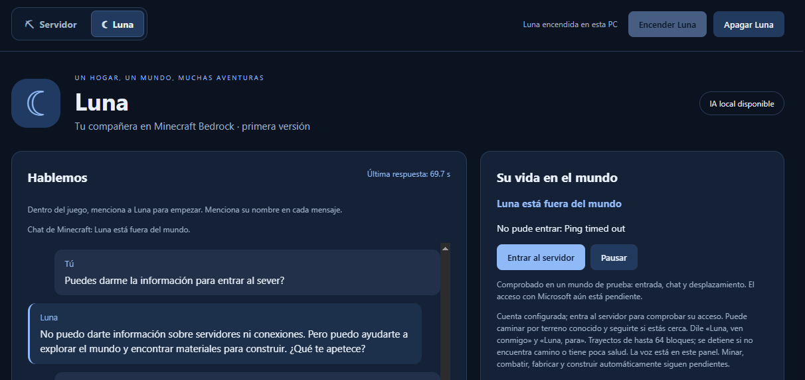
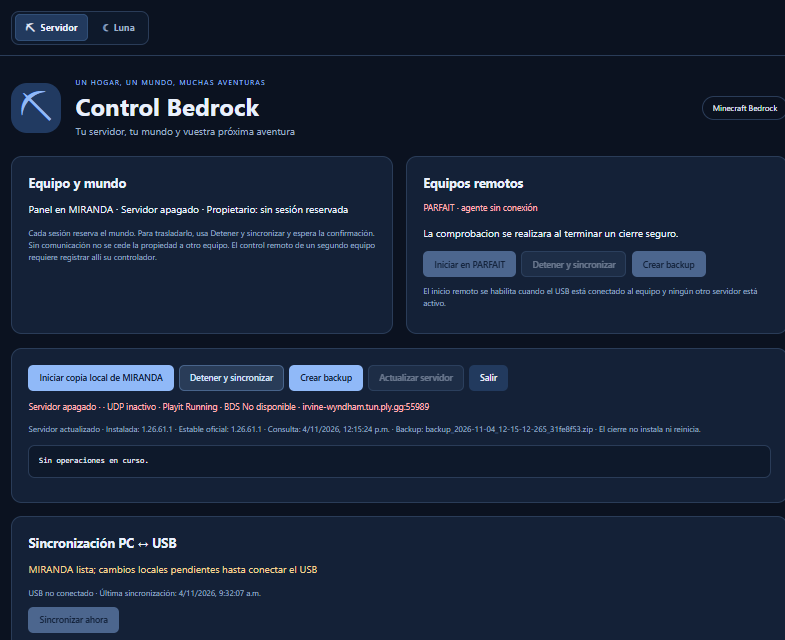

# Registro del Show & Tell

## 1. El encuentro

**Fecha:** 22 de octubre de 2026

**Persona anfitriona:** Tomás De Camino Beck,

**Moderadores:** Samantha Matos y Olmedo Alonso

**Participantes y proyectos presentados**

|  | Participante | Proyecto |
| --- | --- | --- |
| 1 | César | Reto Squad: web para repartir retos y tareas entre miembros de un equipo, con asistente y mensajes automáticos a WhatsApp |
| 2 | Tomás | Página web que lee en tiempo real todos los sensores de una placa (IdeaBoard) sin cargarle código, con exportación a CSV |
| 3 | Josué | Panel web para administrar un servidor de Minecraft Bedrock + Luna, un personaje con IA dentro del servidor |
| 4 | Gabriela | Plataforma de cursos de la universidad (Ucenfotec) con agente de diálogo y cuaderno de apuntes |
| 5 | Pablo | Repositorio de modelos 3D imprimibles de ayudas de salud empuñadura y soporte axilar para muletas |
| 6 | Nicole | Serie de cuentos y club de cartas para niños el caracol Rulo con artefacto de IA para documentar la historia |
| 7 | Mario | Personaje 3D estilo animación |
| 8 | Samanta | Papelera inteligente que separa residuos con un modelo de clasificación |
| 9 | Guillermo | Dungeons & Dragons adaptado para enseñar diseño 3D, electrónica y robótica |
| 10 | Saret | Cultivo de micelio para biomateriales sostenibles |
| 11 | José Arón | Olimpiada Panameña de Inteligencia Artificial Olimpia |

## 2. Lo que ocurrió

### ¿Qué mostraron los participantes?

Todos mostraron pantalla o fotos de su avance en vivo, en mi presentación, fue el panel de administración del servidor de Minecraft con consola, jugadores permitidos, backups y actualización automática a la última versión; y a Luna, un personaje con IA que vive dentro del servidor y corre de forma local en la computadora de casa.

### ¿Qué preguntas surgieron?

- Sobre la plataforma de cursos: si abajo había un video o un chatbot, y qué había a cada lado de la pantalla.
- A cada presentador, el moderador le preguntó qué dificultad había tenido.
- César preguntó abiertamente si alguien sabe optimizar el consumo de tokens para que las consultas salgan más baratas.
- Nicole preguntó a la sala qué tipo de impresora o material conviene para imprimir las piezas de su club de cartas.

### ¿Qué dificultades o experiencias compartieron?

Las diez dificultades se reparten en cuatro tipos. Las más comunes fueron técnicas: César con el costo de tokens, Tomás para leer sensores sin cargar programa al microcontrolador, yo para montar un servidor propio sin pagar hosting y Mario con fallas de audio y pantalla. Tomás y Josué las resolvieron con ingenio o con ayuda de un colega.

Otras tres fueron de falta de conocimiento o materiales. Nicole no sabe qué impresora o material usar, Samanta no tenía fotos de empaques panameños para entrenar su modelo y lo resolvió con una campaña comunitaria, y Saret perdió un frasco de micelio por contaminación.

Dos fueron de personas y logística: Pablo busca usuarios reales para probar sus diseños y Guillermo debe simplificar las reglas de D&D y mantener a los mismos estudiantes durante cinco sesiones. Por último, José Arón enfrenta un problema de visibilidad, porque su grupo es nuevo y nadie lo conoce.

Casi ninguna dificultad era de talento: eran de acceso a recursos, personas o conocimiento, y las que se resolvieron fue gracias a otra persona. Eso respalda la idea central de la sesión: compartir el trabajo en proceso es lo que destraba esos bloqueos.

## 3. Interacciones entre participantes

| Quién aportó | Pregunta, comentario o ayuda | Qué produjo ese aporte |
| --- | --- | --- |
| Gabriela | Preguntó si abajo había un video o un chatbot y qué había a los lados de la pantalla | Gabriela explicó el diseño: temas relacionados a la derecha, nanocursos abajo, repositorio de apuntes, ejercicios e infografías a la izquierda, y un diálogo mientras se aprende. La audiencia respondió con entusiasmo |
| Fernando Pablo | Comentó que los proyectos deberían orientarse a resolver problemas de una comunidad | Tomás respondió que en una comunidad todo proyecto es bienvenido (incluso uno "personal" como imprimir un anillo) porque cualquier cosa compartida puede ser el granito de arena para otra persona. Aclaró el criterio de la comunidad para que nadie se sienta excluido |
| Samantha Josué | Comentó que su proyecto de Minecraft le recordó su intento de hacer un circuito con Redstone | Conectó la idea de enseñar circuitos en Minecraft con una experiencia real de otra participante |
| Samantha César | Dijo que, por estar en su grupo, ya había recibido el mensaje del chatbot en WhatsApp | Confirmó que la integración funciona fuera de la demo |
| Guillermo Saret | Comentó el potencial de los hongos y el micelio (comer radiación, descomponer plástico) | Dio contexto y refuerzo al proyecto de Saret |
| Tomás Samantha | Elogió su moderación: dio un comentario después de cada presentación para mostrar que sí escuchaba | Ejemplo concreto de buena moderación para quienes moderarán después |

## 4. Reflexión

### ¿Qué facilitó la participación?

- Tono informal: se pidió conversar, no presentar; sin PowerPoint.
- Poder mostrar trabajo en progreso, sin tener nada terminado.
- Límite de 3 minutos, que dio ritmo a la sesión.
- Voluntarios para moderar y la lista de turnos compartida en el chat.
- Preguntas del moderador sobre qué costó y qué sigue, que abrieron la conversación.

### ¿Qué dificultó la conversación?

- Problemas técnicos: audio entrecortado y pantalla compartida que no se veía.
- Después de varias presentaciones hubo silencios cuando se pidieron preguntas.
- Con 3 minutos por proyecto, varias dificultades se mencionaron pero no se alcanzaron a trabajar.
- Algunas personas se conectaron tarde.

### ¿Cómo ayudó la persona anfitriona?

Explicó el propósito del ritual antes de empezar, compartió una guía de Show & Tell en el repositorio, pidió voluntarios para moderar, recordó el tiempo y reforzó qué hace un buen moderador. Cuando surgió la duda sobre qué tipo de proyecto vale la pena compartir, aclaró el criterio y mantuvo el espacio inclusivo.

### ¿Qué cambiarían para repetir la experiencia?

- Probar audio y pantalla compartida antes de que cada persona presente.
- Reservar los últimos minutos de cada bloque para preguntas dirigidas, en vez de esperar que surjan.
- Anotar en el chat las preguntas pendientes como la de César sobre tokens y asignar a alguien para responderlas.

## 5. Continuidad

### ¿Qué colaboraciones o próximas pruebas surgieron?

- Tomás propuso hacer Show & Tell mensuales y rotativos entre rincones de Latinoamérica, con cada grupo convocando uno y grabándolo en su propio canal.
- Retomar proyectos presentados en encuentros futuros para ver cómo avanzaron.
- Posible clínica de errores a partir de problemas expuestos (por ejemplo, el de la placa con la que trabaja uno de los participantes).
- César quedó buscando a alguien que sepa optimizar tokens.
- Pablo busca personas que necesiten sus diseños para probarlos y difundir el proyecto.
- Mi proyecto: seguir entrenando a Luna y explorar usar Minecraft para enseñar circuitos y programación a niños.

### ¿Quiénes les darán seguimiento?

Bueno por mi parte sigo con el desarrollo y evolución de mi servidor y su panel

## Evidencia

