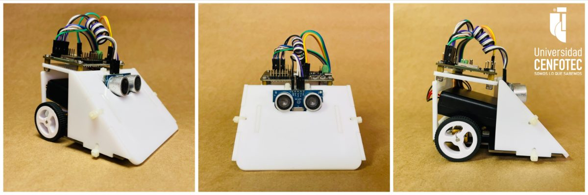
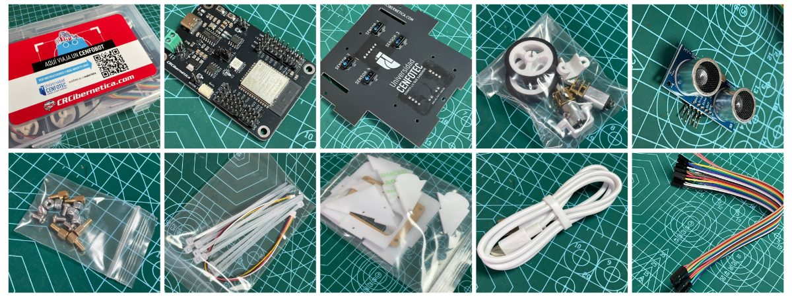
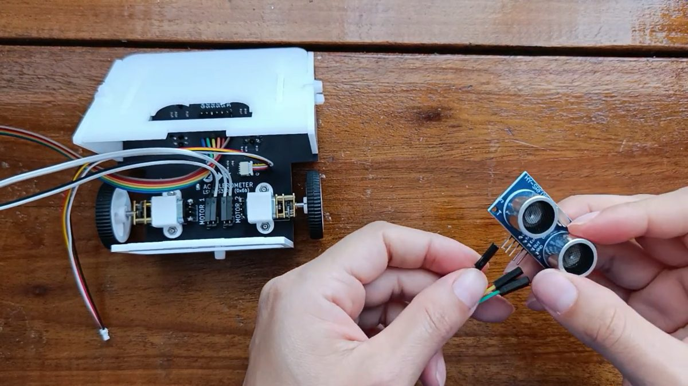
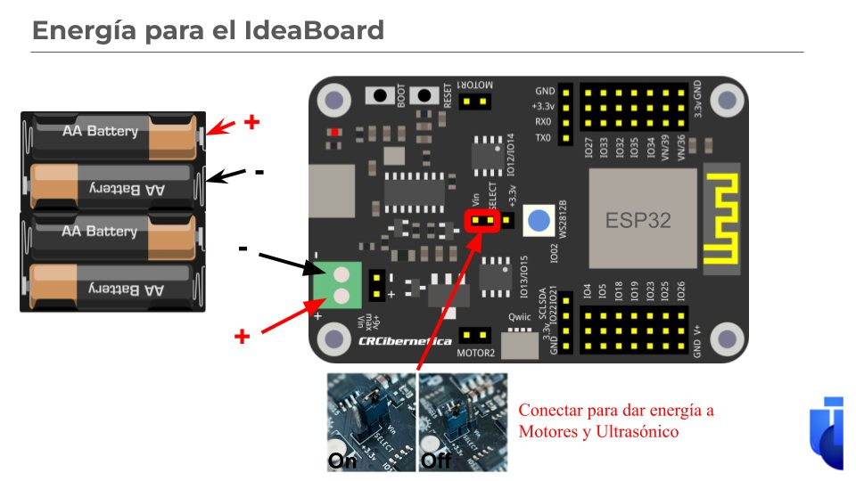
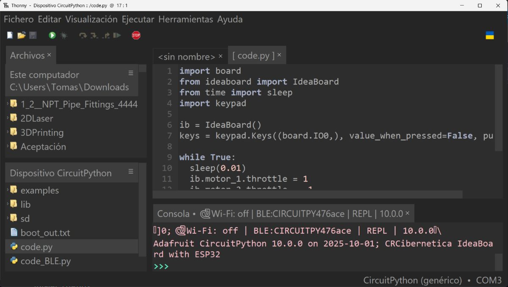
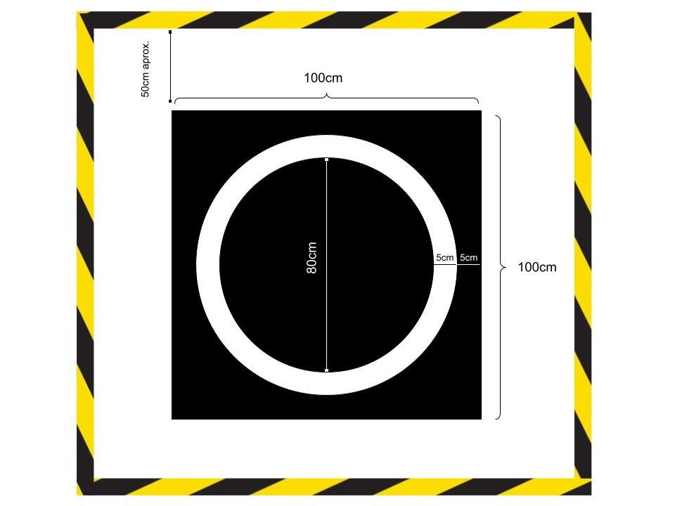
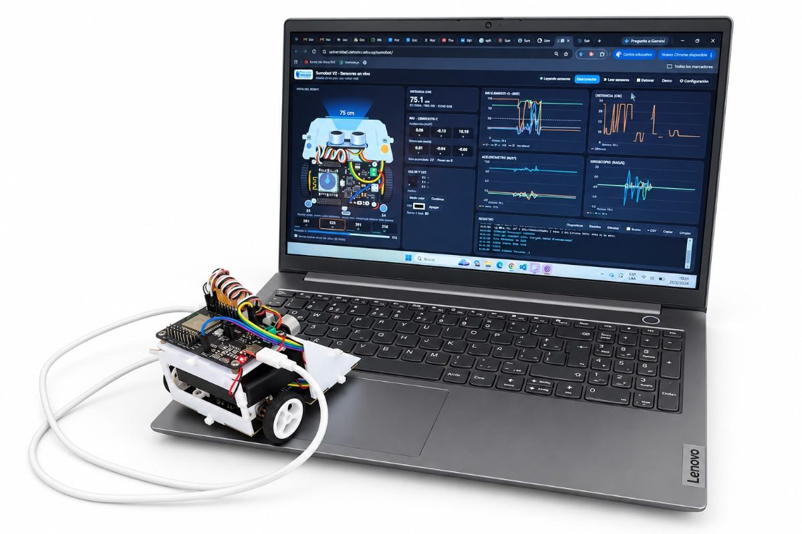

# Primeros pasos con el Sumobot

SINT-741 · Activadores de Comunidades de Práctica · Reto de clase 5 · Grupo 1, Arte y Cultura

> **Para quién es esta guía:** colegiales, docentes y clubes que arman su primer Sumobot y nunca han programado un robot.
> **Cómo usarla:** sigue las seis etapas en orden. Cada etapa dice qué hacer, cómo saber que salió bien y qué documento del repositorio oficial leer para el detalle. Esta guía **no reemplaza** esos documentos: te dice en qué orden leerlos.

| Etapa | Qué logras | Tiempo aproximado |
| --- | --- | --- |
| [1. Conoce el proyecto](#1-conoce-el-proyecto) | Entiendes qué es el Sumobot y el espíritu del torneo | 10 min |
| [2. Revisa el kit](#2-revisa-el-kit) | Confirmas que tienes todas las piezas y herramientas | 15 min |
| [3. Arma y conecta](#3-arma-y-conecta) | El robot queda armado y enciende | 1 a 2 h |
| [4. Prepara la computadora](#4-prepara-la-computadora) | Thonny reconoce al Sumobot | 20 min |
| [5. Tu primer programa](#5-tu-primer-programa) | El robot se mueve con tu código | 30 min |
| [6. Prueba en el dojo](#6-prueba-en-el-dojo) | Compruebas sensores y movimiento antes de competir | 30 min |

> Los tiempos son una estimación del grupo, no un dato del repositorio.

---

## 1. Conoce el proyecto

El Sumobot (también llamado CenfoBot) es un robot de sumo creado por el profesor Tomás de Camino Beck para la Universidad CENFOTEC. Dos robots autónomos se empujan dentro de un círculo y gana el que saca al otro. Todas las piezas se consiguen en Costa Rica, y el diseño y el código son abiertos.

En el torneo importa más aprender que ganar: cada combate sirve para probar ideas, y los problemas se resuelven conversando.

**Lee:**
- [`README.md`](https://github.com/Universidad-Cenfotec/Sumobot/blob/main/README.md): qué es el Sumobot y el índice de todo el repositorio.
- [`espiritu_sumobot.md`](https://github.com/Universidad-Cenfotec/Sumobot/blob/main/espiritu_sumobot.md): el espíritu del torneo.

**Listo cuando:** puedes explicar con tus palabras qué hace el robot y cómo se gana un combate.

---

## 2. Revisa el kit

El kit 2025 incluye:
- La placa PCB que sirve de base del chasis, con los sensores infrarrojos, el acelerómetro y el giroscopio ya integrados.
- La placa IdeaBoard (ESP32).
- Las piezas de acrílico, las tiras plásticas y los cables jumper y Qwiic.
- El sensor ultrasónico.
- La caja para baterías AA.
- Dos motores Microgear de 200 RPM.

**Herramientas que necesitas:**
- Un desatornillador Phillips pequeño.
- Un cautín y estaño para soldar los cables de los motores.
- Pinzas o tijera.
- 4 baterías AA.
- Un cable USB-C.

**Lee:** [`componentes.md`](https://github.com/Universidad-Cenfotec/Sumobot/blob/main/componentes.md).

> ⚠️ En el README del repositorio, el enlace «Componentes del Sumobot» apunta a `componentes2025.md`, que no existe. El archivo correcto es el que enlazamos aquí.

**Listo cuando:** marcaste cada pieza de la lista y tienes las herramientas a mano.

---

## 3. Arma y conecta

El armado no necesita pegamento: todo se sujeta con tornillos y tiras plásticas. El orden es:

1. Motores sobre la placa inferior. Hay que **soldar los cables** a cada motor.
2. Sensores y cables. El cable Qwiic y los sensores infrarrojos van conectados a la placa.
3. Llantas.
4. Estructura de acrílico: laterales, frente y cuerpo.
5. Sensor ultrasónico, conectado a la IdeaBoard.
6. Caja de baterías: cable negro al negativo (−) y rojo al positivo (+).
7. Revisión final con el cable USB-C conectado.

**Lee:**
- [`Armado paso a paso.md`](https://github.com/Universidad-Cenfotec/Sumobot/blob/main/Armado%20paso%20a%20paso.md): los 35 pasos, con [video de armado](https://youtu.be/Cxlyzh-E9kE).
- [`conexiones.md`](https://github.com/Universidad-Cenfotec/Sumobot/blob/main/conexiones.md) y la guía [`Conexiones SumoBot.pdf`](https://github.com/Universidad-Cenfotec/Sumobot/blob/main/Conexiones%20SumoBot.pdf).

**Listo cuando:** al conectar el USB-C se enciende la luz de la IdeaBoard y todas las conexiones están firmes.

---

## 4. Prepara la computadora

El Sumobot se programa en **CircuitPython** con el editor gratuito **Thonny**:

1. Descarga Thonny desde [thonny.org](https://thonny.org/) e instálalo con las opciones por defecto.
2. Abre **Herramientas → Opciones → Intérprete** y elige **«CircuitPython (genérico)»**.
3. Conecta el Sumobot por USB-C y selecciona su puerto (en Windows aparece como «COMx»).
4. En el panel de archivos, abre `code.py` desde el dispositivo CircuitPython.

**Lee:**
- [`instala_thonny.md`](https://github.com/Universidad-Cenfotec/Sumobot/blob/main/instala_thonny.md) y [`uso_thonny.md`](https://github.com/Universidad-Cenfotec/Sumobot/blob/main/uso_thonny.md), dos guías paso a paso que solo se enlazan desde `programacion.md`.
- [`programacion.md`](https://github.com/Universidad-Cenfotec/Sumobot/blob/main/programacion.md): videos y cómo resetear (flashear) la IdeaBoard.

> **¿Sin instalar nada?** También puedes programar desde el navegador con [IdeaCode](https://ideacode.crcibernetica.com/) (CircuitPython) o con bloques en [IdeaScratch](https://ideascratch.crcibernetica.com/).

**Listo cuando:** ves `code.py` del Sumobot abierto en Thonny.

---

## 5. Tu primer programa

Empieza con el **código de inicio** del repositorio. Lo explica sección por sección: librerías, sensores, botón BOOT y funciones de movimiento.

Las funciones básicas son:

| Función | Qué hace |
| --- | --- |
| `forward(t, speed)` | Avanza durante `t` segundos |
| `backward(t, speed)` | Retrocede |
| `left(t, speed)` / `right(t, speed)` | Gira a la izquierda o a la derecha |
| `stop()` | Detiene el robot |
| `lookForward()` | Mide con el ultrasónico la distancia, en cm, a lo que tiene enfrente |
| `forwardCheck(t, speed)` | Avanza, pero retrocede y gira si los sensores infrarrojos detectan el borde |

**Ejercicio sugerido:**
1. Cambia `speed` y `t` en `forward()` y observa la diferencia.
2. Prueba [`test_motores.py`](https://github.com/Universidad-Cenfotec/Sumobot/blob/main/c%C3%B3digos_de_ejemplo/test_motores.py), que mueve el robot en cada dirección y cambia el color del LED.
3. Pasa a [`code_scan.py`](https://github.com/Universidad-Cenfotec/Sumobot/blob/main/c%C3%B3digos_de_ejemplo/code_scan.py), en el que el robot busca al rival y ataca.

**Lee:**
- [`códigos_de_ejemplo/codigo inicio/`](https://github.com/Universidad-Cenfotec/Sumobot/tree/main/c%C3%B3digos_de_ejemplo/codigo%20inicio), con `code.py` explicado.
- [`códigos_de_ejemplo/README.md`](https://github.com/Universidad-Cenfotec/Sumobot/blob/main/c%C3%B3digos_de_ejemplo/README.md), con la lista de todos los ejemplos.
- [`sensores_infrarrojos.md`](https://github.com/Universidad-Cenfotec/Sumobot/blob/main/c%C3%B3digos_de_ejemplo/sensores_infrarrojos.md), sobre cómo detecta el borde blanco del dojo.

**Listo cuando:** el robot avanza, retrocede y gira con tu propio código.

---

## 6. Prueba en el dojo

El dojo es un cuadrado negro de 100 cm con un anillo blanco de 90 cm de diámetro exterior y 5 cm de ancho. Puedes hacer uno de práctica con cartulina negra y cinta, o con madera y pintura.

**Prueba en este orden:**
1. **Sensores:** conecta el robot por USB y abre el [monitor web de sensores](https://universidad-cenfotec.github.io/Sumobot/). Mueve una mano frente al ultrasónico y pasa el robot sobre el borde blanco.
2. **Borde:** carga [`Prueba_Dojo.py`](https://github.com/Universidad-Cenfotec/Sumobot/blob/main/c%C3%B3digos_de_ejemplo/Prueba_Dojo.py), un programa de solo pruebas, y comprueba que el robot no se sale del círculo.
3. **Reglas:** pesa el robot. **No puede pasar de 315 g** con baterías y usa exactamente 4 baterías AA.

**Lee:**
- [`dojo.md`](https://github.com/Universidad-Cenfotec/Sumobot/blob/main/dojo.md): medidas, archivo para imprimir y videos para construir uno.
- [`reglas de competencia.md`](https://github.com/Universidad-Cenfotec/Sumobot/blob/main/reglas%20de%20competencia.md): especificaciones del robot y del torneo.
- [`FAQ.md`](FAQ.md): preguntas frecuentes, ampliadas por nuestro grupo.

**Listo cuando:** el robot detecta el borde en las cuatro esquinas, pesa 315 g o menos y está listo para el torneo. 🎉

---

## ¿Te trabaste o tienes una duda nueva?

Revisa el [FAQ ampliado](FAQ.md). Si tu duda no está, cuéntanos con la [plantilla «Pregunta o experiencia»](plantilla-pregunta-o-experiencia.md). Así la próxima persona la encuentra resuelta.

## Créditos y licencia

- Contenido, imágenes y código de referencia: [Sumobot de la Universidad CENFOTEC](https://github.com/Universidad-Cenfotec/Sumobot), diseñado por Tomás de Camino Beck, con aportes de su comunidad (entre otras personas, Fiorella Pérez y Gabriela Urbina Hernández, autoras de `Prueba_Dojo.py` y `test_motores.py`). El kit y las placas son de CrCibernética.
- Las imágenes de la carpeta `images/` son copias reducidas de la carpeta [`imagenes/`](https://github.com/Universidad-Cenfotec/Sumobot/tree/main/imagenes) del repositorio original.
- Esta guía es una obra derivada, publicada con la misma licencia: [CC BY-NC-SA 4.0](https://creativecommons.org/licenses/by-nc-sa/4.0/deed.es). Puedes compartirla y adaptarla dando crédito y sin fines comerciales.
- Organización y redacción: Grupo 1, Arte y Cultura (SINT-741).
