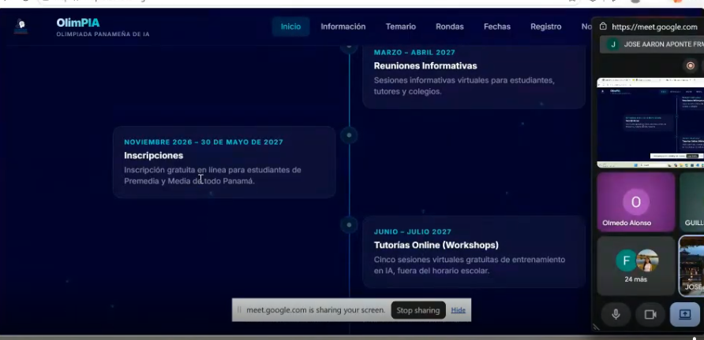
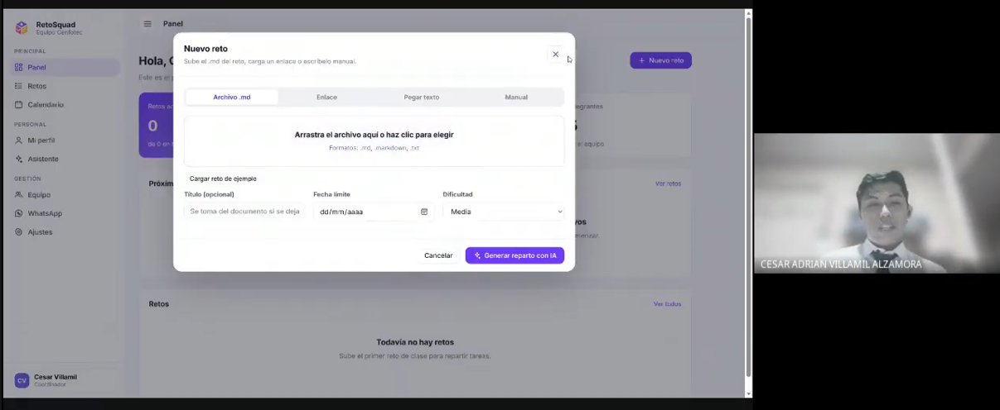

# Reto · Registro del Show & Tell

## 1. El encuentro

- **Fecha:** 22 de octubre de 2026, a las 16:50 (GMT−6).
- **Persona anfitriona:** Tomás De Camino Beck.
- **Moderación:** Samantha Valentina Matos Gutiérrez moderó el primer grupo y Olmedo Alonso el segundo.
- **Participantes y proyectos presentados:**
  - **César Adrián Villamil Alzamora — RetoSquad:** herramienta web para organizar retos y distribuir tareas según intereses, fortalezas y aprendizajes que quiere desarrollar cada integrante del equipo.
  - **Tomás De Camino Beck — visualización de sensores:** página web para leer y visualizar datos de una placa con sensores y exportarlos a CSV.
  - **Josué Antonio Parfait Miranda — panel para un servidor de Minecraft:** herramienta para administrar un servidor propio, sus configuraciones, jugadores, consola y copias de seguridad, con una posible orientación educativa.
  - **Gabriela Urbina Hernández — plataforma de nanocursos:** prototipo de aprendizaje para la Universidad Sinfotec, con videos, diálogo asistido por IA, apuntes, ejercicios y recursos complementarios.
  - **Pablo Daniel Hernández Meléndez — ayudas técnicas imprimibles en 3D:** repositorio en desarrollo de modelos de bajo costo, incluidos una empuñadura y un soporte axilar para muletas.
  - **Nicole Lasso Canto — cuentos infantiles de Rulo:** serie de cuentos conectados y herramienta para documentar la historia, las emociones del personaje y el proceso creativo; también explora una posible propuesta de cartas para niños.
  - **Mario — personaje 3D animado:** personaje de estilo inspirado en la animación cinematográfica; la presentación se centró en la cabeza y en aspectos del rostro, como los ojos animados. El apellido no se distingue con certeza en el fragmento.
  - **Samantha Valentina Matos Gutiérrez — papelera inteligente:** prototipo que busca clasificar residuos y dirigirlos automáticamente a los contenedores correspondientes.
  - **Guillermo Javier González Montenegro — Dungeons & Dragons para enseñar tecnología:** propuesta de juego de rol educativo para enseñar diseño 3D, programación, electrónica y robótica mediante retos.
  - **Saret Jezreel Medina Hernández — Biomico:** experimentación con cultivo de micelio para desarrollar bloques y biomateriales sostenibles, como posibles materiales de empaque.
  - **José Aarón Aponte Franco — Olimpia:** iniciativa para impulsar la participación de estudiantes panameños en olimpiadas de inteligencia artificial.
  - **Olmedo Alonso — idea de investigación sobre necesidades tras el terremoto:** propuesta inicial para conocer la satisfacción con la ayuda recibida y las necesidades de comunidades afectadas.
- **Dinámica:** se organizaron dos grupos de presentaciones, con intervenciones breves de aproximadamente tres minutos. Se invitó a compartir prototipos, código, bocetos, materiales, fotografías, pruebas o ideas en desarrollo. La sesión fue grabada/documentada para que luego se elaborara un registro.
- **Grabación de la sesión:** [Ver la grabación en Google Drive](https://drive.google.com/file/d/1BNPZp9_-4II00XNJH-m5iP0puG2MJiju/view?usp=sharing).

## 2. Lo que ocurrió

### Proyectos y experiencias compartidas

- **RetoSquad:** César explicó que creó la herramienta para mejorar la distribución de tareas en equipos. Incluye retos, calendario, ideas y un asistente. Intentó conectar Gemini para aportar contexto a las tareas, pero encontró dificultades con el consumo y el costo de tokens. También integró mensajes automáticos en el grupo de WhatsApp mediante una librería de Python que interactúa con WhatsApp Web. Solicitó ayuda para optimizar prompts y reducir el consumo. Una persona del equipo confirmó que ya había recibido un mensaje del chatbot.
- **Visualización de sensores:** Tomás mostró una página que lee en tiempo real datos como aceleración, giroscopio, temperatura, luz, humedad relativa y botones. Permite marcar eventos y guardar datos en CSV para analizarlos. Quiere usarla como material educativo, aunque todavía no ha definido las actividades. Comentó que resolvió la lectura directa de los sensores con la ayuda de un amigo, Bentley.
- **Servidor de Minecraft:** Josué mostró un panel para consultar el estado del servidor, gestionar configuraciones y jugadores, ver la consola y administrar copias de seguridad y actualizaciones. Utiliza una computadora antigua como servidor y quiere explorar usos educativos de Minecraft —y quizá Roblox— para enseñar circuitos y programación. También mencionó la necesidad de mantener copias de seguridad y sincronizarlas.
- **Plataforma de nanocursos:** Gabriela explicó un prototipo para ofrecer cursos en temas como inteligencia artificial, ciencia de datos, desarrollo de software y ciberseguridad. Tras conversar con Tomás, está explorando una experiencia más interactiva, en la que el video conviva con un agente conversacional que ayude a tomar apuntes, crear cuadernos de estudio, repasos, diagramas y otros recursos. Nicole preguntó por la distribución de los elementos de la interfaz, y Gabriela describió los temas relacionados, apuntes, ejercicios, infografías, dashboards y evaluaciones.
- **Ayudas técnicas impresas en 3D:** Pablo compartió la idea de crear un repositorio de modelos fáciles de imprimir y de bajo costo. Su equipo ya probó una empuñadura y un soporte axilar para muletas con una persona que necesitaba reparar sus muletas. Entre los retos están validar adecuadamente los diseños, conseguir personas y materiales para nuevas pruebas y publicar los modelos. También se habló de la importancia de lograr una textura apropiada para el agarre.
- **Cuentos infantiles de Rulo:** Nicole presentó una historia de trece cuentos conectados, protagonizados por un caracol llamado Rulo. Su herramienta organiza la línea emocional del personaje, el mapa del viaje, los cuentos y la documentación de su evolución visual, desarrollada con su compañera ilustradora Lexi. También centraliza ideas y notas con apoyo de IA. Explora la posibilidad de un club de cartas mensual para niños, con material complementario para sus familias. Su dificultad más inmediata es conocer las opciones, los materiales y los costos de impresión.
- **Personaje 3D de Mario:** Mario mostró —aunque tuvo problemas al compartir la pantalla y el audio— un personaje 3D de estilo inspirado en la animación de Disney. Explicó que le interesa el arte digital, el diseño y la arquitectura, y que quiere compartir lo que aprende y colaborar con otras personas. Tomás y otros participantes elogiaron el nivel visual del diseño y le sugirieron compartir más información o un pequeño video por WhatsApp.
- **Papelera inteligente:** Samantha presentó videos del proceso de un prototipo para clasificar residuos y depositarlos en los contenedores adecuados. El equipo empezó con modelos pequeños y mecanismos de compuertas, pero decidió avanzar hacia un funcionamiento automático. Aprendieron durante el proceso, incluyendo pruebas iniciales en Google Colab. El sistema todavía no clasifica con suficiente precisión ciertos empaques específicos de Panamá. Para mejorar los datos, organizaron una campaña entre conocidos y en la escuela para recopilar fotos de residuos; cuando el enlace de subida falló, algunas personas enviaron las imágenes por WhatsApp.
- **Dungeons & Dragons educativo:** Guillermo explicó un manual en desarrollo junto con un amigo que vive en España. La propuesta combina juego de rol, trabajo en equipo y retos de diseño 3D, programación, electrónica y robótica. Se contempla una prueba de cinco sesiones con estudiantes y se mencionó como posibilidad el Rincón Clubhouse de Boquete. Las principales dificultades son simplificar las numerosas reglas del juego para que sean comprensibles y coordinar las sesiones cuando la asistencia de estudiantes varía.
- **Biomico:** Saret presentó experimentos de cultivo de micelio para desarrollar bloques y materiales sostenibles, incluidos posibles envases. Está probando técnicas de cultivo en grano, sustrato y líquido. Un frasco se contaminó debido a una esterilización insuficiente y tuvo que preparar otro. El cultivo líquido aún estaba en una fase temprana.
- **Olimpia:** José Aarón presentó una iniciativa de una fundación y un grupo de profesores y profesionales para impulsar las olimpiadas panameñas de inteligencia artificial. La propuesta contempla temas como IA aplicada, ciencia de datos, pensamiento computacional e IA creativa, además de rondas y tutorías en línea. Busca llegar a estudiantes de distintas provincias y preparar a jóvenes para participar en competencias internacionales. Entre los retos están estudiar y adaptar los temarios, coordinar fechas y conseguir reconocimiento y apoyo para una organización nueva.
- **Idea de Olmedo:** Olmedo compartió una propuesta inicial para investigar cómo vivieron las comunidades el terremoto, qué tan satisfechas están con la ayuda recibida y qué necesidades siguen teniendo. Considera recopilar información de distintas zonas de la península y de provincias centrales, aunque reconoce que conseguir respuestas a encuestas puede ser difícil.

### Preguntas, comentarios y dificultades que surgieron

- Se pidió ayuda para optimizar el uso de tokens y prompts en RetoSquad.
- Se comentó que las gráficas de sensores facilitan comprender los datos mejor que una lista de números.
- Nicole preguntó a Gabriela por la organización de la interfaz de nanocursos.
- Fernando Ulises Barría Cornejo elogió la orientación social del proyecto de Pablo. Tomás añadió que tanto los proyectos de impacto social como los personales o experimentales pueden tener valor para la comunidad.
- Se comentaron los posibles usos educativos de Minecraft y de los juegos de rol.
- Se valoró la posibilidad de usar micelio para fabricar empaques y otros objetos.
- Olmedo sugirió que los Rincones Clubhouse podrían ayudar a difundir Olimpia; Nicole también propuso contactar con esos espacios.
- Al final, Tomás abrió una reflexión sobre cómo repetir el formato Show & Tell en otras comunidades y mostró como referencia videos de Show & Tell de Adafruit.

## 3. Interacciones entre participantes

Describan al menos dos ejemplos concretos.

| **Quién aportó** | **Pregunta, comentario o ayuda** | **Qué produjo ese aporte** |
| --- | --- | --- |
| Samantha Valentina Matos Gutiérrez (moderadora) | Confirmó que ya había recibido un mensaje del chatbot de RetoSquad en WhatsApp. | Aportó evidencia de que la integración ya se estaba probando en el contexto real del equipo. |
| Samantha Valentina Matos Gutiérrez (moderadora) | Comentó que las gráficas de los sensores facilitan comprender los datos en comparación con ver únicamente números. | Tomás explicó que la visualización buscaba facilitar la lectura de los datos y su uso educativo. |
| Nicole Lasso Canto | Preguntó a Gabriela cómo estaban distribuidos el video, el chatbot y los demás recursos de la plataforma de nanocursos. | Gabriela explicó las secciones de apuntes, ejercicios, infografías, dashboards y evaluaciones, lo que permitió comprender mejor la experiencia de aprendizaje que está diseñando. |
| Fernando Ulises Barría Cornejo y Tomás De Camino Beck | Fernando destacó el valor comunitario del proyecto de ayudas técnicas imprimibles en 3D de Pablo. Tomás añadió que tanto los proyectos sociales como los personales y experimentales tienen valor. | Se reforzó una visión inclusiva en la que compartir proyectos no depende de que estén terminados o tengan un impacto social amplio. |
| Tomás De Camino Beck y Nicole Lasso Canto | Ayudaron a Mario cuando tuvo problemas al compartir la pantalla y con el audio. Tomás también le sugirió compartir más información o un video por WhatsApp. | Mario pudo continuar explicando su personaje 3D, recibió comentarios positivos sobre el diseño y obtuvo una opción para mostrar mejor su trabajo después de la reunión. |
| Olmedo Alonso y Nicole Lasso Canto | Sugirieron contactar con los Rincones Clubhouse para divulgar la iniciativa Olimpia. | Surgió una posible vía para ampliar la difusión y llegar a estudiantes de distintas comunidades. El contacto y los acuerdos quedaron pendientes de confirmar. |
| Olmedo Alonso y Guillermo Javier González Montenegro | Olmedo preguntó por las principales dificultades del proyecto educativo basado en Dungeons & Dragons. Guillermo explicó que necesitaba simplificar las reglas y mantener la continuidad de las sesiones cuando la asistencia variaba. | Quedaron identificados obstáculos concretos que habría que resolver antes de probar la propuesta educativa. |
| Samantha Valentina Matos Gutiérrez y Tomás De Camino Beck | Samantha propuso considerar un formato híbrido, destacando la cercanía de los encuentros presenciales y el alcance de los virtuales. Tomás coincidió y señaló que la modalidad virtual facilita compartir proyectos mediante imágenes y videos. | Se reconocieron las ventajas complementarias de los formatos virtual y presencial para mantener una comunidad participativa. |
| Josué Antonio Parfait Miranda | Comentó que el Show & Tell permite encontrar personas con intereses similares, conseguir ayuda especializada y descubrir posibles colaboradores. | Se destacó la colaboración entre participantes como uno de los principales beneficios de este tipo de encuentros. |
| Vianca Vidal Cuevas Jordan | Propuso replicar el círculo de ideas presencialmente con jóvenes de su comunidad y destacó la importancia de cultivar su imaginación. | Surgió la posibilidad de llevar la dinámica a otros espacios comunitarios y educativos. |
| Olmedo Alonso y Pablo Daniel Hernández Meléndez | Olmedo preguntó a Pablo por las principales dificultades de su proyecto de ayudas técnicas. Pablo explicó que necesitaba más personas y materiales para realizar pruebas y validar los diseños. | La conversación permitió precisar las necesidades prácticas para continuar desarrollando y probando las ayudas técnicas. |
| Tomás De Camino Beck y Samantha Valentina Matos Gutiérrez | Tomás reconoció la labor de Samantha y Olmedo como moderadores, destacando la escucha activa y la capacidad de mantener las conversaciones centradas en los proyectos. | Se valoró la importancia de una moderación que facilite la participación y mantenga un ambiente respetuoso y colaborativo. |

## 4. Reflexión

- **¿Qué facilitó la participación?**
  - La estructura breve y la organización en grupos permitieron que varias personas presentaran sus proyectos.
  - Se aceptaron distintos formatos: demostraciones, prototipos, videos, fotografías, herramientas digitales e ideas aún en desarrollo.
  - El tono informal y las preguntas posteriores ayudaron a convertir las presentaciones en conversaciones.
  - El reconocimiento respetuoso de los proyectos y la moderación activa contribuyeron a que las personas se sintieran escuchadas.
  - La diversidad de temas permitió que participantes con intereses diferentes encontraran puntos de conexión.

- **¿Qué dificultó la conversación?**
  - Hubo problemas técnicos de audio y de compartir pantalla, entre ellos durante la presentación de Mario y al comenzar la intervención de Guillermo.
  - Hubo una confusión con el orden de la lista y Pablo tuvo que señalar que aún no había presentado.
  - El tiempo breve de cada presentación limitó algunos detalles y preguntas.
  - Varios proyectos enfrentan retos técnicos o logísticos: consumo de tokens, lectura de sensores, copias de seguridad, precisión de clasificación de residuos, contaminación de cultivos, validación de ayudas técnicas, impresión y coordinación de sesiones educativas.
  - En la propuesta de Olmedo, lograr que las personas respondan encuestas es una dificultad prevista, no una solución ya probada.

- **¿Cómo ayudó la persona anfitriona?**
  - Tomás explicó la dinámica y la necesidad de documentar la sesión.
  - Organizó la moderación entre Samantha y Olmedo y respaldó a quienes presentaban cuando surgían problemas técnicos o de organización.
  - Felicitó a Samantha por su escucha activa y reconoció el trabajo de ambos moderadores.
  - Mantuvo el foco de las conversaciones y animó a hacer preguntas.
  - Recalcó que no hace falta tener un proyecto terminado ni preparar una presentación formal: compartir una idea en proceso también puede inspirar y recibir aportes.
  - Promovió una comunidad abierta a proyectos tecnológicos, educativos, artísticos, personales y sociales.

- **¿Qué cambiarían para repetir la experiencia?**
  - Confirmar previamente la lista y el orden de presentaciones.
  - Probar audio, pantalla y enlaces antes de empezar.
  - Mantener un espacio breve para preguntas después de cada presentación sin perder el control del tiempo.
  - Reservar explícitamente un bloque final para reflexiones y posibles colaboraciones.
  - Recopilar en un documento los enlaces a los proyectos y las solicitudes de ayuda para facilitar el seguimiento.
  - Considerar encuentros virtuales regulares y actividades presenciales ocasionales, según las necesidades de la comunidad.

## 5. Continuidad

- **César / RetoSquad:** buscar apoyo para optimizar prompts y reducir el consumo de tokens de Gemini. **Seguimiento:** no se asignó una persona concreta en los fragmentos disponibles.
- **Tomás / visualización de sensores:** definir actividades educativas que puedan construirse sobre la plataforma. **Seguimiento:** pendiente de confirmar.
- **Josué / servidor de Minecraft:** explorar actividades educativas con Minecraft y posiblemente Roblox, circuitos y programación. **Seguimiento:** idea futura; no se confirmó una colaboración formal.
- **Gabriela / nanocursos:** continuar el prototipo de aprendizaje interactivo y la integración de recursos conversacionales. **Seguimiento:** Gabriela y su equipo; los acuerdos concretos no se detallaron.
- **Pablo / ayudas técnicas 3D:** conseguir materiales y participantes para probar diseños, validar las piezas y difundir los modelos. **Seguimiento:** Pablo y su equipo; responsables específicos por confirmar.
- **Nicole / cuentos de Rulo:** continuar la escritura, la documentación creativa junto con Lexi y explorar el posible club de cartas. También necesita investigar opciones y costos de impresión. **Seguimiento:** Nicole y Lexi en el trabajo creativo; no se confirmó un plan formal para el club.
- **Mario / personaje 3D:** compartir un video o más información por WhatsApp para que el grupo pueda conocer mejor el proceso. **Seguimiento:** sugerido por Tomás; confirmar si se realizó.
- **Samantha / papelera inteligente:** seguir mejorando la precisión del clasificador y recopilar imágenes de empaques locales. **Seguimiento:** Samantha y su equipo; no se detallaron responsables individuales.
- **Guillermo / Dungeons & Dragons educativo:** simplificar y revisar el manual, diseñar las cinco sesiones y explorar una posible prueba con el Rincón Clubhouse de Boquete. **Seguimiento:** Guillermo y su colaborador; la prueba aún no está confirmada.
- **Saret / Biomico:** continuar las pruebas de cultivo de micelio y mejorar los procedimientos de esterilización. **Seguimiento:** Saret; próximos pasos específicos por confirmar.
- **José Aarón / Olimpia:** divulgar la iniciativa y ampliar el alcance a estudiantes de todo Panamá. Se propuso contactar con Rincones Clubhouse para apoyar la difusión. **Seguimiento:** José Aarón y el equipo de Olimpia; el contacto y los acuerdos concretos están por confirmar.
- **Olmedo / investigación posterior al terremoto:** explorar una forma de recopilar información sobre satisfacción con la ayuda y necesidades pendientes en las comunidades afectadas. **Seguimiento:** idea en fase inicial; método y responsables por confirmar.
- **Comunidad Show & Tell:** valorar la repetición de estos encuentros, tanto virtuales como presenciales, y promover que más personas compartan proyectos en diferentes etapas. **Seguimiento:** no se asignó una persona responsable ni una fecha para la próxima sesión.

## Evidencia

- **Grabación de la sesión:** [Ver la grabación en Google Drive](https://drive.google.com/file/d/1BNPZp9_-4II00XNJH-m5iP0puG2MJiju/view?usp=sharing).
- **Fecha de la sesión:** 22 de octubre de 2026, a las 16:50 (GMT−6).
- **Enlaces a proyectos:** solicitados a los participantes quedan pendientes de agregar.
- **Capturas, fotografías o videos autorizados:** agregados en la carpeta de evidencias

## 6. Evidencia

La siguiente evidencia visual complementa el registro de las presentaciones del Show & Tell del 22 de octubre de 2026. Las capturas documentan lo que se mostró durante la reunión; por sí solas no verifican que todas las funcionalidades estén terminadas o funcionando en producción.

### 6.1. Papelera inteligente — Samantha Valentina Matos Gutiérrez

Captura de un video mostrado durante la reunión, en el que se observa el prototipo físico de la papelera inteligente.

**Archivo:** `evidencias/Screenshot ShowAndTell.png`

### 6.2. OlimPIA — José Aarón Aponte Franco

Captura de la plataforma OlimPIA, donde se observa el cronograma de actividades, incluidas las inscripciones, las reuniones informativas y los talleres en línea.

**Archivo:** `evidencias/ScreenshotShowAndTellOlimpia.png`

### 6.3. RetoSquad — César Adrián Villamil Alzamora

Captura del panel de RetoSquad y del formulario para crear un nuevo reto mediante un archivo Markdown, un enlace, texto pegado o entrada manual.

**Archivo:** `evidencias/ScreenshotShowandTellRetoSquad.png`

### 6.4. Grabación de la sesión

[Ver la grabación de la sesión en Google Drive](https://drive.google.com/file/d/1BNPZp9_-4II00XNJH-m5iP0puG2MJiju/view?usp=sharing).

### 6.5. Evidencia complementaria 

- capturas de pantalla de la reunión incorporadas en la carpeta de "evidencias"
