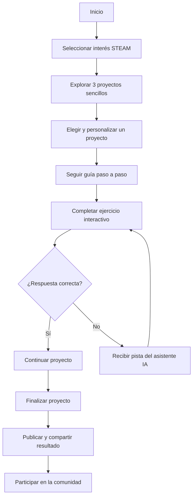

# 🛠️ Mapa de comunidad: MakeralDia

**Proyecto:** MakeralDia  
**Área:** Tecnología, innovación y cultura maker  
**Estado:** Primera versión del proyecto

🔗 **[Ver prototipo web en Figma](https://www.figma.com/make/oB6NH1TdBdtcvShx3EsZUQ/MakeralDia-Prototipo-Web?t=EELi5HcKAd8gh3YO-1)**

---

## 👥 Integrantes

- Alexandra Dominguez
- Pablo Daniel Hernández
- Kevin Fernández
- Ailyn Escobar
- Gilary González
- Juan Quiel
- Carlos Batista

---

## 🎯 1. Situación e intención

Queremos crear una **plataforma maker basada en los intereses de las personas**, para que no sientan la tecnología como algo ajeno y puedan **aprender creando proyectos que tengan sentido para ellas** y compartir lo aprendido con otros.

La plataforma busca capacitar a personas de todas las edades en temas maker de manera didáctica, interactiva y accesible.

### Objetivos

- Acercar la tecnología a personas de diferentes edades.
- Promover el aprendizaje mediante proyectos prácticos.
- Fomentar la creatividad y la innovación.
- Facilitar el aprendizaje colaborativo.
- Incorporar inteligencia artificial como herramienta de apoyo.
- Crear una comunidad donde las personas compartan conocimientos y experiencias.

---

## 🌐 2. Dominio

La comunidad se enfoca en:

- Temas STEAM de interés para las personas.
- Tecnología y cultura maker.
- Robótica y electrónica.
- Programación y desarrollo de software.
- Diseño e impresión 3D.
- Inteligencia artificial aplicada al aprendizaje.
- Innovación y creación de proyectos.

---

## 🤝 3. Comunidad

La plataforma está dirigida a personas con diferentes niveles de conocimiento tecnológico.

### Participantes y capacidades

| Participantes | Capacidades que podrían aportar |
|---|---|
| Personas con interés en tecnología | Ideas, pruebas de uso, proyectos personalizados y apoyo a principiantes. |
| Personas que buscan conocimientos básicos | Preguntas reales que permitan identificar qué guías crear primero. |
| Estudiantes y personas makers | Guías paso a paso, prototipos y mentorías. |
| Educadores y facilitadores | Orientación pedagógica, recursos educativos y acompañamiento. |
| Empresas | Planes de entrenamiento, mentores y oportunidades de empleo. |

### ¿Cómo puede participar una persona nueva?

1. Ingresar a la plataforma MakeralDia.
2. Explorar los temas disponibles.
3. Seleccionar un área STEAM de su interés.
4. Elegir un proyecto adecuado a sus conocimientos.
5. Seguir las instrucciones paso a paso.
6. Resolver dudas con apoyo de la comunidad o del asistente IA.
7. Compartir su proyecto y experiencia.

---

## 💡 4. Práctica compartida

Se propone desarrollar actividades que fomenten el aprendizaje práctico y la colaboración.

### Actividades propuestas

- **Reto maker semanal:** desarrollar un proyecto sencillo según el interés de cada participante.
- **Sesiones colaborativas:** encuentros presenciales o virtuales para crear proyectos y resolver dudas.
- **Ejercicios interactivos:** actividades dentro de la plataforma con evaluación inmediata.
- **Asistente virtual IA:** apoyo para comprender conceptos y resolver dificultades.
- **Repositorio de proyectos:** espacio para almacenar y compartir creaciones.
- **Mentorías comunitarias:** participantes con experiencia apoyan a quienes comienzan.

### Recursos disponibles

- Plataforma web.
- Herramientas digitales gratuitas.
- Asistente de inteligencia artificial.
- Documentos colaborativos.
- Repositorio de proyectos.
- Conexión a internet.
- Computadoras o dispositivos móviles.

---

## 🚀 5. Trayectorias de participación

La propuesta se basa en tres principios:

**Practicar → Entender → Crear comunidad**

| Acción | Cómo se concreta |
|---|---|
| Observar | Ver proyectos y guías publicadas por otras personas sin necesidad de crear una cuenta. |
| Preguntar | Consultar al asistente IA o plantear dudas a la comunidad. |
| Contribuir | Personalizar un proyecto y publicar su versión con una breve explicación. |
| Acompañar | Quienes completaron un proyecto ayudan a otras personas que están comenzando. |

### Niveles de participación

**Nivel 1: Explorador**
- Descubre proyectos.
- Consulta información.
- Identifica sus intereses.

**Nivel 2: Aprendiz**
- Selecciona un proyecto.
- Sigue instrucciones.
- Completa ejercicios prácticos.

**Nivel 3: Creador**
- Desarrolla proyectos propios.
- Personaliza soluciones.
- Comparte resultados.

**Nivel 4: Mentor**
- Comparte conocimientos.
- Responde preguntas.
- Acompaña a nuevos integrantes.

---

## 🔄 6. Representación de la propuesta

### Flujo de funcionamiento

### Ejemplo práctico

Una persona interesada en programación podría:

1. Seleccionar **Programación**.
2. Visualizar tres proyectos para principiantes.
3. Elegir **Crear una página web sencilla**.
4. Personalizar el nombre, colores y contenido.
5. Completar ejercicios HTML directamente en la plataforma.
6. Recibir retroalimentación inmediata.
7. Consultar al asistente IA cuando tenga dudas.
8. Finalizar y compartir su página con la comunidad.

### Prototipo visual

**Prototipo desarrollado en Figma:**

[MakeralDia - Prototipo Web](https://www.figma.com/make/oB6NH1TdBdtcvShx3EsZUQ/MakeralDia-Prototipo-Web?t=EELi5HcKAd8gh3YO-1)

> En esta sección se puede agregar posteriormente una captura de pantalla o imagen del prototipo.

---

## 🖥️ 7. Prototipo y función

### Función principal

Guiar a una persona, incluso con pocos conocimientos tecnológicos, desde uno de sus intereses hasta la elección y personalización de un proyecto sencillo.

### Componentes propuestos

**1. Selección de intereses STEAM**

El usuario identifica las áreas tecnológicas que más le interesan.

**2. Catálogo de proyectos**

Se presentan tres proyectos iniciales, con descripción, dificultad y opciones de personalización.

**3. Guías paso a paso**

Cada proyecto cuenta con instrucciones claras para facilitar su desarrollo.

**4. Ejercicios interactivos**

La persona escribe directamente en la plataforma textos, comandos o fragmentos de código.

La plataforma evalúa las respuestas y ofrece retroalimentación inmediata.

**5. Asistente virtual IA**

Ayuda a comprender las instrucciones, resuelve dudas y proporciona pistas cuando una actividad presenta dificultades.

**6. Comunidad colaborativa**

Permite compartir resultados, intercambiar experiencias y aprender de otros participantes.

### Estado del prototipo

| Elemento | Estado |
|---|---|
| Nombre del proyecto | Definido |
| Comunidad objetivo | Definida |
| Flujo de participación | Diseñado |
| Estructura de la plataforma | Propuesta |
| Prototipo visual en Figma | Enlace disponible |
| Ejercicios interactivos funcionales | Pendiente de verificar o desarrollar |
| Integración del asistente IA | Pendiente de verificar o desarrollar |
| Pruebas con usuarios | Pendientes |

---

## 🧪 8. Prueba y aprendizaje

### Objetivo de la prueba

Comprobar si una persona con poca experiencia tecnológica puede navegar por la plataforma, identificar un proyecto de su interés, comprender cómo comenzar y completar una actividad sencilla.

### Procedimiento propuesto

1. Invitar de 3 a 5 personas con poca experiencia técnica.
2. Solicitar que seleccionen un área de interés.
3. Pedirles que elijan un proyecto sin ayuda del equipo.
4. Observar si comprenden las instrucciones.
5. Evaluar si logran completar el ejercicio interactivo.
6. Verificar si entienden la retroalimentación recibida.
7. Registrar las dificultades encontradas.
8. Solicitar opiniones y sugerencias.

### Indicadores de evaluación

| Indicador | Qué se observará |
|---|---|
| Facilidad de navegación | Si encuentra un tema de interés sin ayuda. |
| Comprensión | Si entiende cómo iniciar el proyecto. |
| Interacción | Si completa el ejercicio propuesto. |
| Retroalimentación | Si comprende los mensajes de evaluación. |
| Asistente IA | Si recibe orientación útil para continuar. |
| Motivación | Si manifiesta interés en realizar otro proyecto. |
| Tiempo | Cuánto tarda en completar la actividad. |

### Resultados y aprendizajes

| Aspecto | Estado |
|---|---|
| Qué esperábamos | Que la mayoría encuentre un proyecto de interés y pueda iniciarlo sin ayuda. |
| Qué hicimos | Pendiente: la prueba todavía no se ha ejecutado. |
| Qué ocurrió | Pendiente de resultados. |
| Qué aprendimos | Pendiente de resultados. |
| Qué cambiaríamos | Se definirá después de analizar la retroalimentación. |

---

## 🔁 9. Continuidad

La propuesta busca que MakeralDia pueda crecer progresivamente y mantenerse activa con la participación de sus integrantes.

### Acciones de continuidad

- Publicar nuevos proyectos maker periódicamente.
- Desarrollar retos semanales.
- Crear una biblioteca de proyectos realizados.
- Formar mentores dentro de la comunidad.
- Documentar experiencias y soluciones.
- Incorporar nuevos integrantes.
- Establecer alianzas con instituciones educativas.
- Promover programas de capacitación empresarial.

### Programas empresariales

Se propone que las empresas puedan crear planes de entrenamiento para fortalecer las habilidades tecnológicas de las personas y contribuir a futuras oportunidades de empleo.

### Próxima acción

Construir o completar una maqueta navegable y ejecutar una prueba con 3 a 5 participantes.

**Responsables:** Por acordar entre los integrantes del grupo.

**Fecha:** Por definir.

### Cómo puede continuar otra persona

Se elaborará documentación sencilla que incluya:

1. Objetivo de cada actividad.
2. Recursos utilizados.
3. Instrucciones paso a paso.
4. Dificultades encontradas.
5. Soluciones implementadas.
6. Recomendaciones para futuras actividades.

De esta manera, otros participantes podrán repetir, adaptar o mejorar las actividades.

---

## 🤖 10. Uso de inteligencia artificial y retroalimentación

### Herramienta utilizada

**Gema del círculo generador maker**

La inteligencia artificial se utilizó como apoyo para organizar, explorar y mejorar las ideas del proyecto.

### ¿En qué ayudó la IA?

- Organización del documento `mapa-comunidad.md`.
- Propuesta de prácticas compartidas.
- Identificación de trayectorias de participación.
- Diseño del flujo de funcionamiento.
- Propuesta de actividades colaborativas.
- Elaboración del procedimiento de prueba.
- Identificación de indicadores de evaluación.

### Ideas y decisiones del grupo

Las decisiones principales tomadas por los integrantes incluyen:

- El nombre **MakeralDia**.
- La selección de temas STEAM.
- La comunidad objetivo.
- El enfoque de aprender creando.
- La trayectoria: practicar, entender y crear comunidad.
- La incorporación de ejercicios interactivos.
- La propuesta de un asistente virtual IA.
- La posibilidad de crear programas empresariales.

### Retroalimentación pendiente

Después de presentar y probar el prototipo, se recopilarán opiniones sobre:

- Facilidad de uso.
- Claridad de las instrucciones.
- Utilidad de los proyectos.
- Comprensión de los ejercicios.
- Funcionamiento del asistente IA.
- Recomendaciones para mejorar la plataforma.

Estas opiniones permitirán ajustar la propuesta a las necesidades reales de sus participantes.

---

## 📊 11. Resultados observados, supuestos y tareas pendientes

### Resultados observados

Todavía no se han registrado resultados de pruebas con usuarios.

### Supuestos iniciales

1. Las personas se motivan más cuando aprenden a partir de sus propios intereses.
2. Un asistente IA puede ayudar a usuarios con pocos conocimientos tecnológicos.
3. Los ejercicios interactivos con evaluación inmediata pueden facilitar el aprendizaje.
4. Compartir proyectos puede fortalecer la colaboración.
5. Las empresas podrían estar interesadas en crear planes de entrenamiento tecnológico.

Estos supuestos deberán validarse mediante las pruebas y la retroalimentación de los participantes.

### Tareas pendientes

- [ ] Completar o validar la maqueta navegable.
- [ ] Seleccionar tres proyectos sencillos de ejemplo.
- [ ] Diseñar los ejercicios interactivos.
- [ ] Establecer criterios de evaluación.
- [ ] Verificar el funcionamiento del asistente IA.
- [ ] Seleccionar de 3 a 5 participantes para la prueba.
- [ ] Ejecutar la prueba de usabilidad.
- [ ] Registrar resultados y observaciones.
- [ ] Recopilar retroalimentación.
- [ ] Definir responsables y fechas.
- [ ] Incorporar capturas del prototipo.
- [ ] Actualizar la documentación del proyecto.

---

## ✅ 12. Conclusión

**MakeralDia** propone transformar la manera en que las personas se relacionan con la tecnología, pasando de ser simples consumidoras de información a convertirse en creadoras de proyectos.

A través de experiencias prácticas, aprendizaje colaborativo, recursos interactivos y apoyo de inteligencia artificial, buscamos construir una comunidad donde cualquier persona pueda aprender, experimentar y compartir conocimientos.

Esta primera versión constituye el punto de partida para validar la propuesta, recibir retroalimentación y continuar desarrollando una plataforma maker accesible, participativa y orientada a los intereses de sus integrantes.

---

**Proyecto:** MakeralDia  
**Documento:** `mapa-comunidad.md`  
**Versión:** 1.0 – Propuesta inicial  
**País:** Panamá  

**Prototipo:** [Ver MakeralDia en Figma](https://www.figma.com/make/oB6NH1TdBdtcvShx3EsZUQ/MakeralDia-Prototipo-Web?t=EELi5HcKAd8gh3YO-1)
