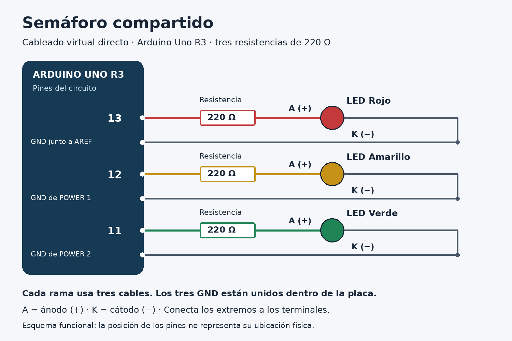

# Semáforo compartido: tu primer circuito con Arduino en Tinkercad

**Curso:** Activadores de Comunidades de Práctica · SENACYT / CENFOTEC.  
**Público:** docentes y estudiantes principiantes de Panamá y Costa Rica.  
**Duración estimada:** 20–30 minutos con la cuenta iniciada; puede tomar más la primera vez.  
**Versión 0.1:** revisión documental y lógica realizada; simulación y revisión con otro grupo pendientes.

## Para qué sirve

Simularás un semáforo de tres LED —pequeñas luces electrónicas—: **rojo 8 segundos → verde 8 segundos → amarillo 3 segundos**. Podrás relacionar conexiones e instrucciones, modificar un tiempo y dejar una mejora para quien continúe la experiencia.

## Qué necesitás

- Computadora con internet, navegador y acceso a [Tinkercad](https://www.tinkercad.com/). Comprueba tu cuenta o acceso de clase antes de comenzar.
- Saber arrastrar elementos y copiar texto; no necesitas programar todavía.
- **Componentes virtuales:** 1 Arduino Uno R3, 3 LED individuales —rojo, amarillo y verde— y 3 resistencias de **220 Ω**.
- **9 conexiones de cable:** se crean pulsando terminales; no se buscan como componentes.

Trabajarás directamente entre terminales, sin protoboard. El código completo está aquí. GitHub solo requiere cuenta para publicar aportes.

## Cómo hacerlo

### 1. Crear el espacio de trabajo

Entra en Tinkercad, abre **Circuitos / Circuits** y elige **Crear nuevo circuito / Create new Circuit**. Ponle el nombre `Semáforo compartido`. Los nombres de los botones pueden variar según el idioma.

### 2. Agregar y preparar los componentes

Arrastra un **Arduino Uno R3**, tres **LED** y tres **Resistencia / Resistor**. Si falta alguno, cambia el filtro a **Todos / All**.

Selecciona cada LED, asigna su color y ordénalos: rojo, amarillo y verde. Selecciona cada resistencia y fija **220 Ω**, no kΩ. La resistencia limita la corriente del LED.

### 3. Conectar los nueve cables

Con la simulación detenida, pulsa el terminal de origen y luego el de destino para crear cada cable. Acercar componentes o cruzar cables no establece una conexión.

Pasa el puntero por los terminales del LED para identificar **ánodo (A, +)** y **cátodo (K, −)**. En un LED físico corresponden generalmente a la pata larga y corta, respectivamente; en pantalla confirma las etiquetas.

Conecta **tres cables por fila**, siguiendo esta tabla:

| LED | Cable 1 | Cable 2 | Cable 3 |
| --- | --- | --- | --- |
| Rojo | Pin **13** → extremo de su resistencia | Otro extremo de esa resistencia → **ánodo** del rojo | **Cátodo** del rojo → **GND junto a AREF y 13** |
| Amarillo | Pin **12** → extremo de su resistencia | Otro extremo de esa resistencia → **ánodo** del amarillo | **Cátodo** del amarillo → uno de los **GND de POWER** |
| Verde | Pin **11** → extremo de su resistencia | Otro extremo de esa resistencia → **ánodo** del verde | **Cátodo** del verde → el otro **GND de POWER** |

Los dos GND de POWER están entre **5V y VIN**. Los tres GND comparten la misma referencia eléctrica. Usa uno distinto por LED. Las resistencias no tienen orientación; **cada LED lleva la suya**.



El esquema es funcional: no reproduce la posición física de los pines. La tabla permite montar sin ver la imagen.

### 4. Pegar el programa

Abre **Código / Code → Texto / Text**. Acepta el aviso de cambio de editor en este circuito nuevo. Sustituye todo el programa por este código, sin copiar las marcas Markdown de tres acentos graves:

```cpp
// Semaforo compartido: Arduino Uno R3.
// Rojo: 13; amarillo: 12; verde: 11.
// Una resistencia de 220 ohmios en serie con cada LED.
const int rojo = 13;
const int amarillo = 12;
const int verde = 11;

void setup() {
  pinMode(rojo, OUTPUT);
  pinMode(amarillo, OUTPUT);
  pinMode(verde, OUTPUT);
  digitalWrite(rojo, LOW);
  digitalWrite(amarillo, LOW);
  digitalWrite(verde, LOW);
}

void loop() {
  // Fase roja: 8 segundos.
  digitalWrite(verde, LOW);
  digitalWrite(amarillo, LOW);
  digitalWrite(rojo, HIGH);
  delay(8000);

  // Fase verde: 8 segundos.
  digitalWrite(rojo, LOW);
  digitalWrite(amarillo, LOW);
  digitalWrite(verde, HIGH);
  delay(8000);

  // Fase amarilla: 3 segundos.
  digitalWrite(rojo, LOW);
  digitalWrite(verde, LOW);
  digitalWrite(amarillo, HIGH);
  delay(3000);
}
```

`setup()` prepara las salidas una vez. `loop()` repite las fases. En este circuito, `HIGH` enciende un LED y `LOW` lo apaga. `delay(8000)` espera 8000 milisegundos, equivalentes a 8 segundos.

### 5. Iniciar y observar

Pulsa **Iniciar simulación / Start Simulation** y observa **los tres LED externos** durante dos ciclos. El LED integrado **L** también usa el pin 13 y puede acompañar al rojo; no lo cuentes como parte del semáforo.

## Cómo comprobar que funcionó

Usa el tiempo del simulador; si la computadora está lenta puede diferir del tiempo de tu reloj.

| Tiempo aproximado desde el inicio | LED externo encendido | Los otros dos |
| --- | --- | --- |
| 0 a menos de 8 segundos | Rojo | Apagados |
| 8 a menos de 16 segundos | Verde | Apagados |
| 16 a menos de 19 segundos | Amarillo | Apagados |
| Al llegar a 19 segundos | Vuelve el rojo | Comienza otro ciclo |

La prueba pasa si hay **un solo LED externo encendido por fase**, en el orden indicado, y el ciclo se repite. Dos ciclos duran unos **38 segundos de simulación**. Registra cualquier diferencia.

**Variante opcional:** después de verificar el original, detén la simulación y cambia `delay(3000)` por `delay(5000)`. Al reiniciar, el amarillo debe durar 5 segundos y el ciclo 21. Documenta el cambio.

## Qué aprendimos y qué falta resolver

La práctica relaciona salidas y tiempos. Se contrastó la guía con fuentes oficiales y se comprobó la lógica del código localmente; falta ejecutar este circuito en Tinkercad.

| Si ocurre esto | Revisa esto |
| --- | --- |
| Un LED no enciende | Ánodo hacia la resistencia, cátodo hacia GND y cables unidos a terminales. |
| Solo parpadea el LED pequeño de la placa | Que esté cargado el programa completo y que los LED externos estén conectados. |
| Se enciende un color distinto | Correspondencia de los pines: 13 rojo, 12 amarillo, 11 verde. |
| Una luz es muy tenue o aparece una advertencia | Valor de cada resistencia: **220 Ω**, y una resistencia por LED. |
| El programa muestra un error | Editor en Texto, bloque completo, llaves y puntos y coma; no copies las marcas Markdown. |

**Pendiente:** simular este montaje, recoger la interpretación de otro grupo y medir el tiempo con principiantes. El montaje físico y los bloques quedan para futuras ampliaciones.

## Cómo podés contribuir

**Ayúdanos a aclarar una instrucción.** Lee o prueba la guía e indica el primer paso que requiere ayuda: número, qué entendiste y cómo lo aclararías. También sirve confirmar que pudiste seguirla.

En este repositorio abre **Issues → New issue**, con el título `Prueba de la guía del semáforo`. Incluye **tipo de revisión** —lectura o simulación—, **paso**, **resultado o duda** y **sugerencia**. Copia cualquier mensaje de error; la captura del circuito es opcional.

Sin GitHub, envía esos datos por el canal del curso. El grupo podrá registrarlos con tu autorización. No hace falta programar para aportar.

## Autoría y fuentes

**Grupo:** [COMPLETAR: nombre del grupo].  
**Integrantes y aportes:** [COMPLETAR: nombres y contribución de cada persona].  
**Origen:** adaptación de una práctica introductoria de semáforo con Arduino Uno. Identificar al integrante que la aporta y sus pruebas previas en el registro de clase.  
**Apoyo de IA:** claridad y comprobación lógica; ver [revisión con IA](../revision/revision-ia.md). La prueba de uso sigue pendiente.

Fuentes de consulta —enlaces a materiales originales, sin incorporar sus imágenes—:

- [Arduino: Blink](https://docs.arduino.cc/built-in-examples/basics/Blink/) — LED, polaridad y resistencia en serie.
- [Arduino Uno R3: distribución oficial de pines](https://content.arduino.cc/assets/A000066-full-pinout.pdf) — identificación de salidas y GND.
- [Arduino: delay()](https://docs.arduino.cc/language-reference/en/functions/time/delay/) — tiempos en milisegundos.
- [Autodesk: guía oficial de Tinkercad Circuits](https://images.tinkercad.com/jl5ii4oqrdmc/4sMFqe3rDlbUymJt0I4yh/85a4487f7fe274e74c19870ae4679fc1/tinkercad-guides_circuits-Printable.pdf) — uso del editor y simulación.

**Reutilización:** contenido propio —textos, esquema original y código educativo— bajo [CC BY 4.0](https://creativecommons.org/licenses/by/4.0/): reconocer autoría, enlazar la licencia e indicar cambios. Las fuentes conservan sus condiciones. Completar créditos y confirmar esta elección antes de publicar; ver [LICENCIA.md](../LICENCIA.md).

## Revisión durante la clase

**Estado inicial: pendiente.** Completar con las respuestas reales del otro grupo, antes de dar explicaciones orales.

| Pregunta | Respuesta del otro grupo |
| --- | --- |
| ¿Qué podemos hacer con este recurso? | [PENDIENTE] |
| ¿Qué necesitamos para comenzar? | [PENDIENTE] |
| ¿Cuál sería el primer paso? | [PENDIENTE] |
| ¿Cómo sabríamos que funcionó? | [PENDIENTE] |
| ¿Dónde necesitaríamos pedir ayuda? | [PENDIENTE] |

**Fecha y grupo revisor:** [PENDIENTE].  
**Tipo de revisión realizada:** [PENDIENTE: comprensión / simulación / ambas].  
**Qué explicamos oralmente:** [PENDIENTE].  
**Qué ajustamos y en qué paso:** [PENDIENTE: registrar un cambio real o indicar que no se realizaron cambios y por qué].  
**Prueba práctica:** [PENDIENTE: no realizada / realizada con resultado y evidencia].

Conserven el detalle en el [registro de clase](../revision/registro-clase.md). Leer y comprender no equivale a ejecutar el circuito.
