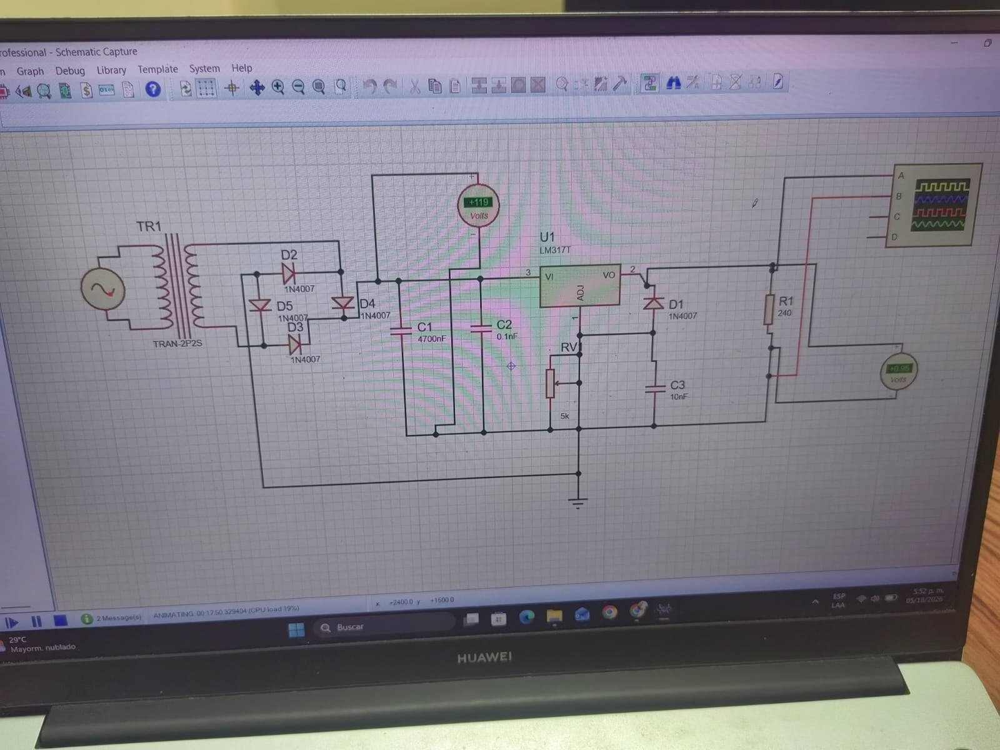
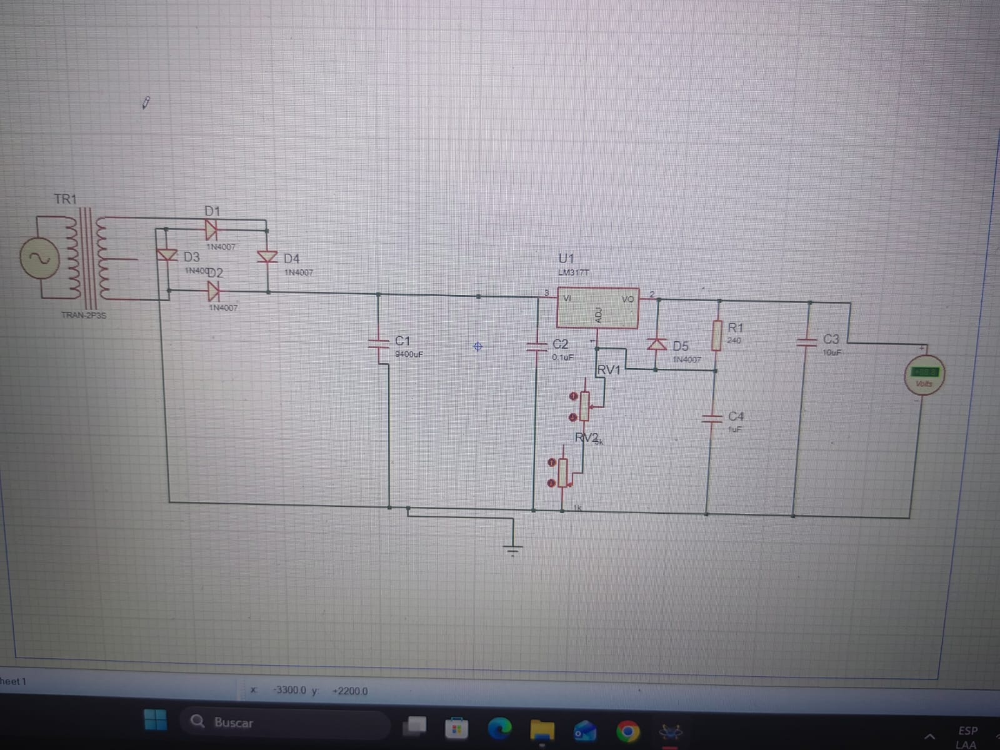
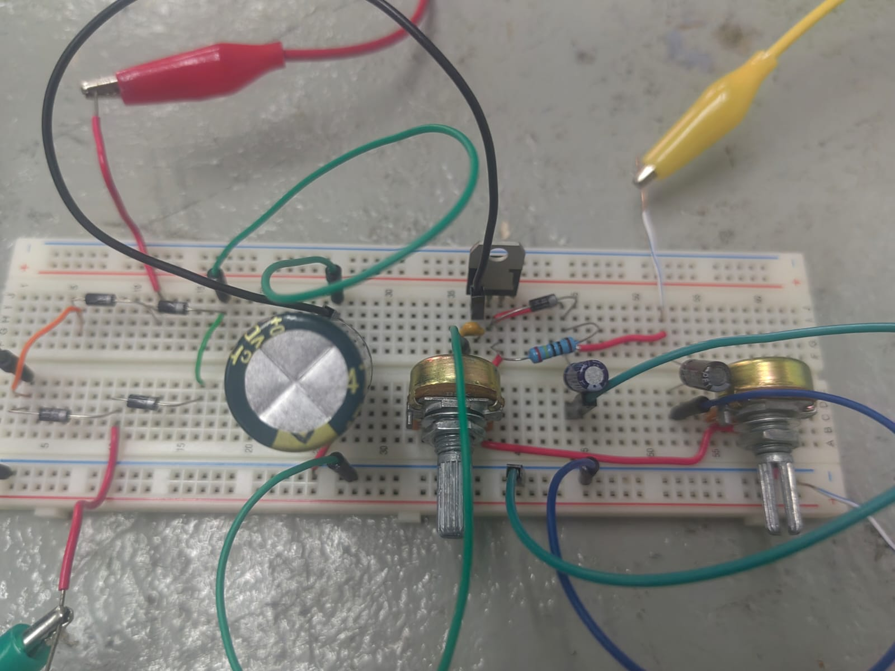
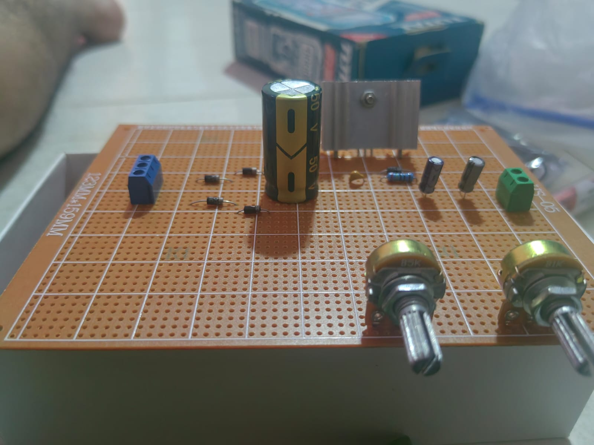
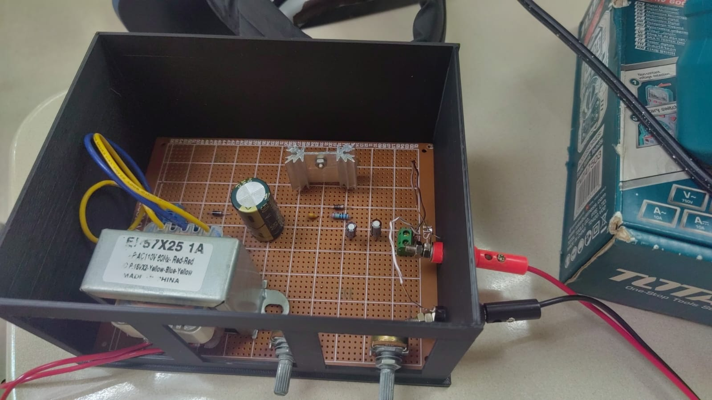

# Fuente de Voltaje Regulable Casera (`fuente-voltaje-regulable-0-25v`)

## Nombre del proyecto
**Fuente de Voltaje DC Regulable Casera con LM317** (`fuente-voltaje-regulable-0-25v`)

## Descripción
Prototipo funcional de una fuente de alimentación de corriente continua (DC) regulable basada en el regulador lineal ajustable **LM317T**. El sistema toma 120 V AC de la red eléctrica (60 Hz), los reduce mediante un transformador a 18 V AC (~25.5 V pico), rectifica la señal con un puente de diodos 1N4007 y filtra el rizado para entregar una salida DC estabilizada y ajustable mediante un potenciómetro lineal de **5 kΩ**.

En la práctica, el voltaje máximo regulado alcanza aproximadamente **21 V – 22 V DC** en vacío (limitado por el voltaje rectificado del secundario del transformador y el margen *dropout* del LM317), mientras que el límite inferior es de **1.25 V** (si se conecta el potenciómetro directo a tierra) o **~4.8 V** (si se mantiene la resistencia fija `R3` de 680 Ω en serie). El diseño térmico está dimensionado para operar de forma segura hasta **0.5 A** continuos.

## Problema o necesidad
Este proyecto nació para cubrir dos necesidades concretas:
1. **Académica:** Desarrollar y validar un prototipo funcional como proyecto de curso universitario de electrónica.
2. **Práctica:** Contar con una fuente de alimentación propia y económica en el banco de trabajo para alimentar y probar futuros circuitos y proyectos personales sin depender exclusivamente del equipo de laboratorio.

## Público objetivo
Estudiantes de ingeniería o técnico en electrónica, *makers* y cualquier persona aficionada a la electrónica básica que desee comprender cómo funciona una fuente lineal regulada y construir su propio prototipo desde cero.

## Origen
La idea surgió como asignación práctica en una materia universitaria de electrónica, buscando aplicar conceptos fundamentales de rectificación, filtrado capacitivo y regulación lineal de voltaje en un equipo útil para el taller personal.

## Estado actual
* **Hardware:** Primer prototipo armado y operativo sobre **placa perforada** con todos sus componentes soldados, utilizando un potenciómetro lineal de **5 kΩ** en la etapa de ajuste.
* **Simulación y documentación:** Circuito esquemático diseñado y verificado en **Proteus**, acompañado de la lista de materiales (BOM) y cálculos térmicos y eléctricos disponibles en `docs/fuente_LM317_componentes.xlsx`.

### Evidencia visual del prototipo

Las imágenes siguientes son las **fotografías originales a resolución completa**, sin reducirlas a miniaturas. Haz clic en cualquiera para abrir el archivo original.

Las capturas de Proteus corresponden a iteraciones del esquema y pueden mostrar valores diferentes de los indicados en la lista de materiales.

**Esquema en Proteus — simulación con instrumentos (1600 × 1200):**

**Otra iteración del esquema en Proteus (1600 × 1200):**

**Pruebas iniciales sobre protoboard (1600 × 1200):**

**Placa perforada, antes de soldar (1600 × 1200):**

**Vista superior del prototipo integrado en el gabinete (1599 × 899):**

---

## Cómo comenzar

### Conocimientos previos recomendados
* **Electricidad básica:** Ley de Ohm, leyes de Kirchhoff, equivalente de Thévenin y diferencia entre corriente alterna (AC) y corriente continua (DC).
* **Electrónica básica:** Funcionamiento y polaridad de diodos rectificadores, resistencias, potenciómetros, capacitores electrolíticos/cerámicos y reguladores de voltaje lineales.

### Herramientas y software necesarios
* **Software de simulación:** Proteus o NI Multisim (para explorar y validar el esquemático antes de montar).
* **Herramientas de banco:** Multímetro digital, cautín para soldar, estaño, pinza pelacables, base/soporte para soldar y osciloscopio (recomendado para verificar el rizado de la señal).

### Lista de materiales (BOM)

| N.º | Designador | Componente | Valor / Especificación | Cantidad | Función en el circuito |
| :-: | :--- | :--- | :--- | :-: | :--- |
| 1 | T1 | Transformador | 120 V AC → 18 V AC, mín. 1 A, 60 Hz | 1 | Reduce el voltaje de la red eléctrica |
| 2 | D1–D4 | Diodos rectificadores 1N4007 | 1 A / 1000 V (puente) | 4 | Rectificación de onda completa |
| 3 | C1 | Capacitor electrolítico | 4700 µF / 35 V | 1 | Filtro principal del rizado DC |
| 4 | C3 | Capacitor cerámico | 0.1 µF (100 nF) | 1 | Supresión de ruido en la entrada del LM317 |
| 5 | C2 | Capacitor electrolítico | 10 µF / 25 V | 1 | Estabilidad y menor ruido en la salida |
| 6 | U1 | Regulador de voltaje | LM317T (encapsulado TO-220) | 1 | Regulación lineal ajustable de voltaje |
| 7 | R1 | Resistencia | 240 Ω, 0.25 W | 1 | Entre OUT y ADJ; fija el voltaje de referencia (1.25 V) |
| 8 | R2 | Potenciómetro lineal | 5 kΩ | 1 | Entre ADJ y GND; ajusta el voltaje de salida |
| 9 | R3 | Resistencia fija (en serie con R2) | 680 Ω, 0.25 W *(opcional)* | 1 | Fija el límite inferior en ~4.8 V (sin R3 baja hasta 1.25 V) |
| 10 | D5–D6 | Diodos de protección 1N4007 | 1 A / 1000 V | 2 | D5: OUT–IN; D6: ADJ–OUT (cátodo al lado de mayor voltaje) |
| 11 | HS1 | Disipador de calor | Para TO-220, ≤ 3.9 °C/W + pasta térmica | 1 | Evacúa el calor disipado por el LM317 |
| 12 | F1 | Fusible y portafusible | 500 mA o 1 A, 125 V | 1 | Protección contra sobrecorriente / cortocircuito |
| 13 | SW1 | Interruptor ON/OFF | SPST, 120 V AC | 1 | Encendido y apagado general |
| 14 | LED1 | LED indicador | Rojo, 5 mm | 1 | Indica presencia de voltaje en la salida |
| 15 | R4 | Resistencia del LED | 1 kΩ, 0.25 W | 1 | Limita la corriente del LED indicador |
| 16 | J1–J2 | Bornes de salida | 1 rojo (+) y 1 negro (−) | 2 | Conexión de la carga de prueba |
| 17 | — | Cable de alimentación con clavija | Calibre 18 AWG | 1 | Conexión segura a la red de 120 V AC |
| 18 | — | Cable de conexión | Calibre 20–22 AWG | Varios | Interconexión interna de componentes |
| 19 | — | Placa perforada | Estándar | 1 | Base de montaje del prototipo actual |
| 20 | — | Caja plástica o gabinete | Con ranuras de ventilación | 1 | Encapsulado y aislamiento mecánico |

### Precauciones de seguridad
Antes de armar, soldar o energizar la fuente de alimentación, toma en cuenta estas medidas básicas de seguridad eléctrica:

* **Aislamiento de la etapa primaria (120 V AC):** El devanado primario del transformador, el interruptor `SW1` y el portafusible `F1` trabajan directamente con voltaje de red doméstica (120 V AC). Asegura todas las conexiones con materiales de aislamiento adecuados y nunca manipules esa zona con el cable conectado a la toma de corriente.
* **Polaridad de capacitores electrolíticos:** Verifica la orientación correcta de `C1` (4700 µF / 35 V) y `C2` (10 µF / 25 V) antes de energizar el circuito. Conectar un capacitor electrolítico con polaridad invertida puede dañarlo o hacerlo estallar.
* **Descarga de capacitores:** Antes de realizar mediciones de continuidad o retocar soldaduras, desconecta la fuente y verifica con un multímetro que el capacitor principal `C1` se haya descargado por completo. No asumas que basta con esperar.
* **Uso seguro del cautín:** Trabaja en un área ventilada, apoya siempre el cautín en su base metálica cuando no lo estés usando y evita tocar la punta caliente o inhalar el humo del estaño directamente.
* **Disipación térmica:** El regulador `LM317T` puede alcanzar temperaturas elevadas. Utiliza un disipador dimensionado para las condiciones reales y evita tocarlo durante las pruebas con carga.

> **Aviso:** Una foto del montaje, la presencia de un fusible o un gabinete no demuestran que el equipo esté protegido frente a contactos con 120 V AC. Es indispensable la revisión de una persona cualificada antes de energizarlo.

---

## Próximos pasos
* **Diseño de PCB:** Migrar el circuito de la placa perforada a una placa de circuito impreso (PCB) para mejorar la estética, robustez mecánica y confiabilidad eléctrica.
* **Encapsulado en 3D:** Diseñar e imprimir en 3D un gabinete protector con ventilación adecuada y montaje firme para los bornes e interruptor.
* **Instrumentación:** Incorporar un módulo display digital (voltímetro/amperímetro) para visualizar en tiempo real el voltaje y la corriente entregados.
* **Mejora de componentes:** Reemplazar el interruptor actual por uno de mayor calidad y durabilidad.

## Declaración de uso de Inteligencia Artificial
Para la estructuración, verificación técnica de cálculos y redacción de la documentación de este repositorio (`README.md`, `CONTRIBUTING.md`, propuesta de *Issue* y *Pull Request*), así como para la organización automatizada de carpetas, se utilizaron **Gemini** y **ChatGPT** como asistentes. Toda la información técnica, valores reales de los componentes montados (incluyendo el potenciómetro de 5 kΩ), estado del prototipo y alcance del circuito fueron validados directamente a partir del diseño real en Proteus y las mediciones del prototipo físico.