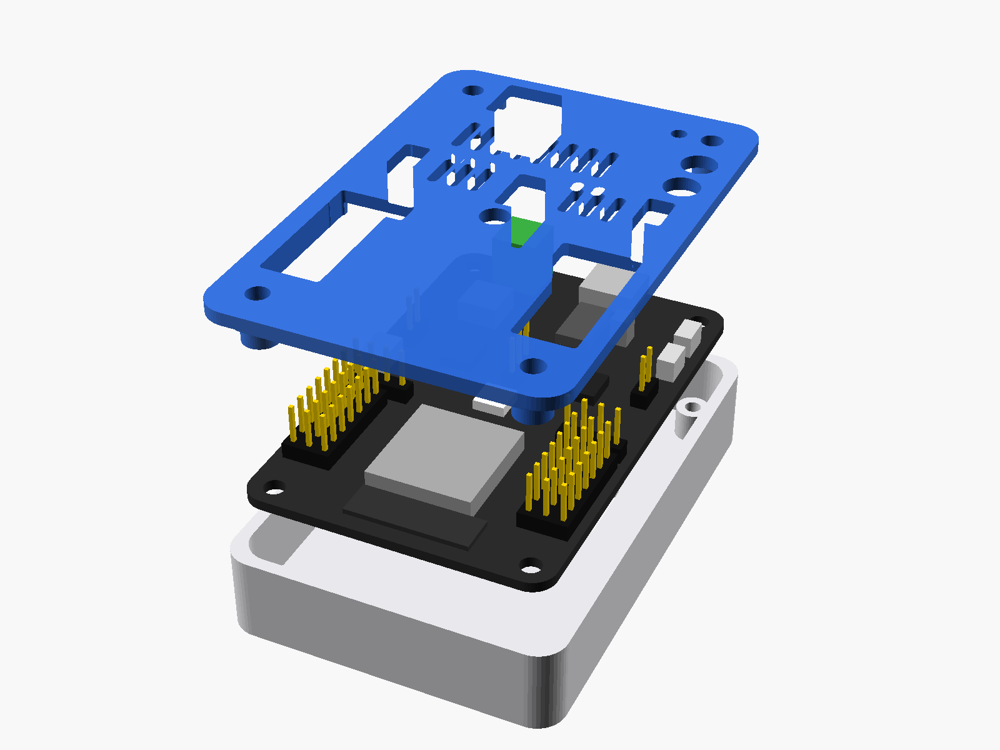

# Carcasa para IdeaBoard

Base y tapa atornilladas. La tapa tiene ventanas para usar los pines, la bornera, el USB-C y los botones con la carcasa cerrada.

| Archivo | Uso |
|---|---|
| `stl/tapa.stl`, `stl/base.stl` | Listos para imprimir (PLA, capa de 0,2 mm, sin soportes) |
| `step/tapa.step`, `step/base.step` | Para editar en Fusion 360, FreeCAD, etc. (la tapa viene en posición de impresión) |
| `carcasa_ideaboard.scad` | Modelo paramétrico: medidas de la placa, holguras, vigas. **Fuente única** del estándar de acople |

Cómo imprimirla y comprobarla: [ficha de fabricación](../../recursos/carcasa-ideaboard.md).
Regenerar un STL: `openscad -D 'parte="tapa_imprimir"' -o tapa.stl carcasa_ideaboard.scad`

