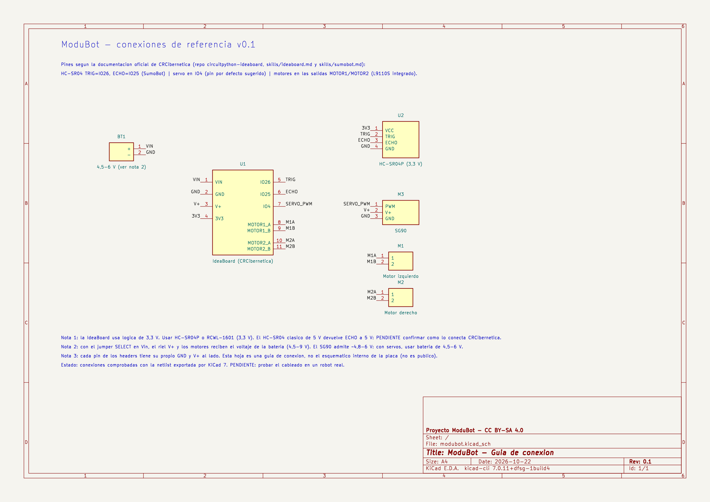

# Electrónica · guía de conexión (KiCad)

Esquemático de referencia para cablear ModuBot: IdeaBoard, 2 motores DC, sensor ultrasónico, servo y batería. Se hizo con KiCad 7.

| Archivo | Uso |
|---|---|
| `modubot.kicad_pro`, `modubot.kicad_sch` | Proyecto editable en KiCad 7 o superior |
| `modubot.pdf`, `conexiones.png` | Para ver o imprimir sin KiCad |

## Pines usados (fuente: documentación oficial de CRCibernética)

| Componente | Pin de la IdeaBoard | Fuente |
|---|---|---|
| Motor izquierdo / derecho | Salidas MOTOR1 y MOTOR2 (driver L9110S integrado) | [wiki: Pinouts](https://github.com/CRCibernetica/circuitpython-ideaboard/wiki/2.-Pinouts-and-Jumper-Settings) |
| Ultrasónico TRIG / ECHO | IO26 / IO25 | `skills/sumobot.md` del [repositorio oficial](https://github.com/CRCibernetica/circuitpython-ideaboard) |
| Servo (señal) | IO4 | `skills/ideaboard.md` (pin sugerido por defecto) |
| Batería | Bornera de 4,5–9 V | wiki: Overview |

## Precauciones (pendiente de verificar en un robot real)

- **Lógica de 3,3 V:** usar un ultrasónico compatible con 3,3 V (HC-SR04P o RCWL-1601). El HC-SR04 clásico de 5 V entrega ECHO a 5 V. Falta confirmar cómo lo conecta CRCibernética en su SumoBot.
- **Servos:** con el jumper SELECT en Vin, el riel V+ recibe el voltaje de la batería. El SG90 admite unos 4,8–6 V, así que con servos conviene una batería de 4,5–6 V.
- Esto es una **guía de conexión**, no el esquemático interno de la IdeaBoard, que no es público.

**Comprobado:** la netlist exportada por KiCad conecta cada pin con el que corresponde. **Pendiente:** probar el cableado en un robot.
