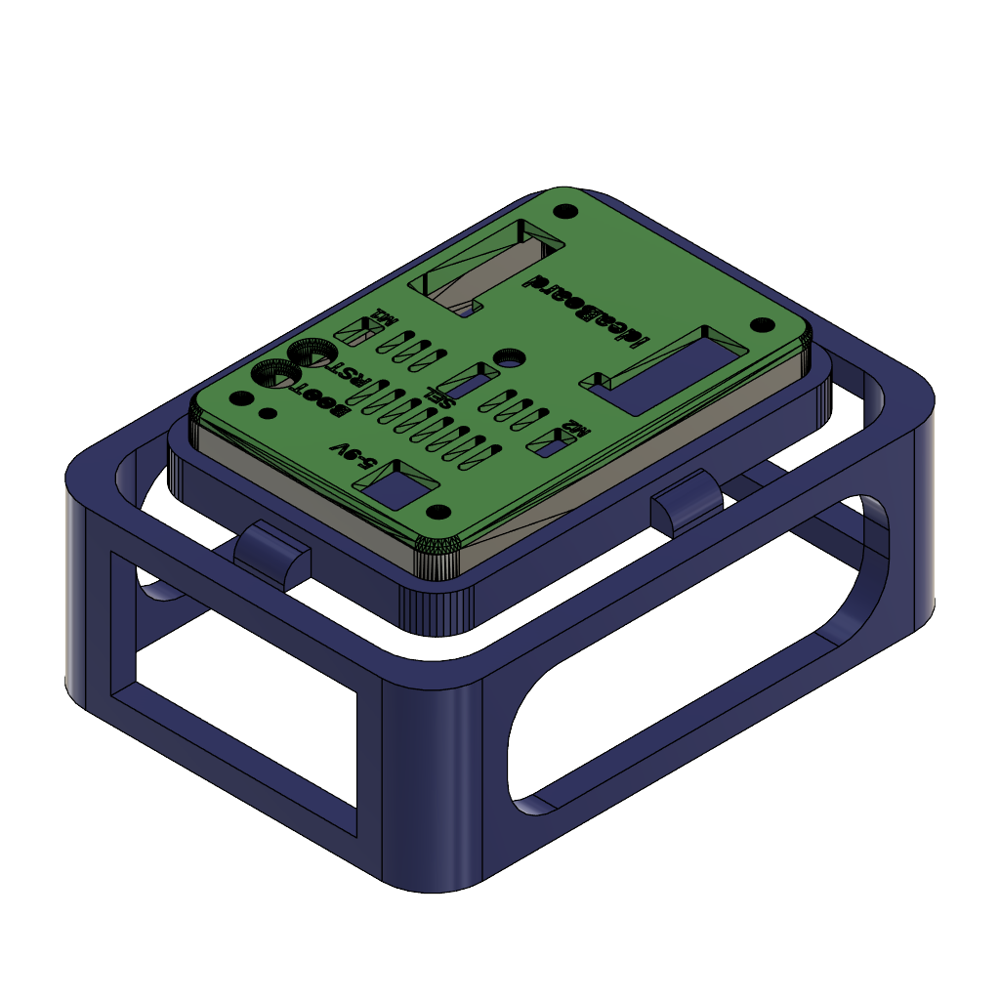
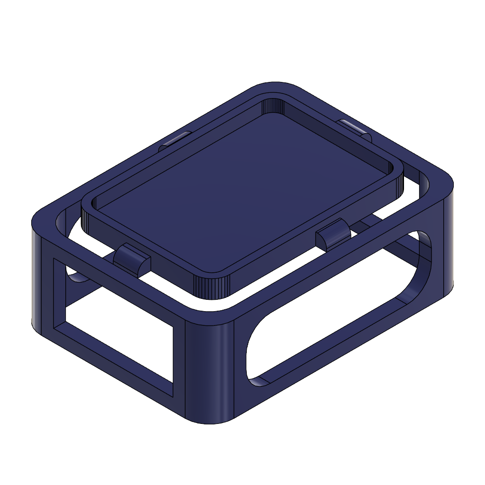

# Estructura (chasis) · Fusion 360

Diseño del equipo en Autodesk Fusion 360. `Edubot.f3z` es un ensamblaje con referencias a sus piezas:

| Componente | Qué es |
|---|---|
| `Edubot` | Ensamblaje principal |
| `Estructura` | Chasis con ventanas laterales y pestañas que sujetan la carcasa |
| `base1`, `tapa1` | Base y tapa de la carcasa v0.1, importadas |

Para abrirlo: en Fusion 360, *Archivo → Abrir → Abrir desde mi equipo* y elegir `Edubot.f3z`.

| Ensamblaje | Estructura |
|---|---|
|  |  |

## Pendiente

- [ ] Exportar `Estructura` a **STEP** y **STL**, para que se pueda editar y fabricar sin Fusion.
- [ ] Reemplazar `tapa1` (v0.1, con textos) por la tapa v0.2.
- [ ] Documentar las medidas de las pestañas o adaptarlas al [estándar de acople](../../docs/estandar-de-acople.md).
