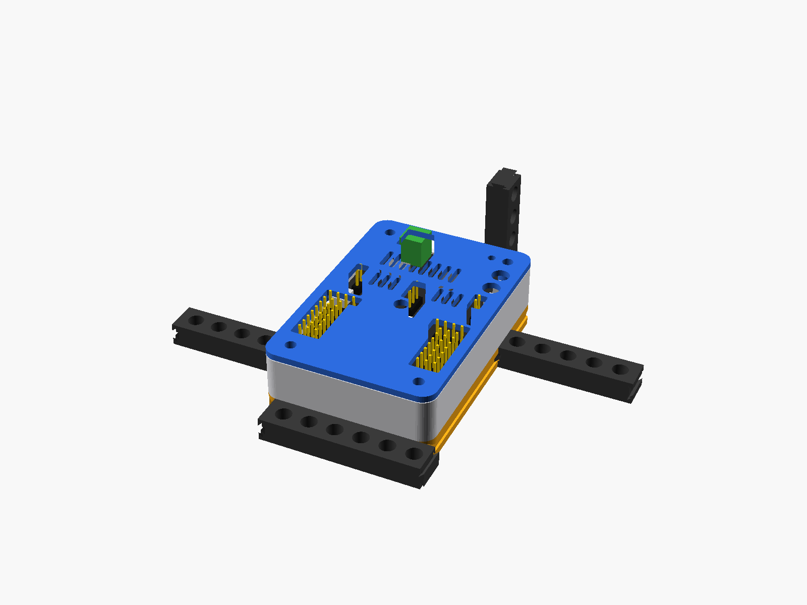

# Sistema de vigas con cola de milano

Vigas, conectores y un adaptador para montar la carcasa en un robot. Siguen el [estándar de acople](../../docs/estandar-de-acople.md).

| STL | Qué es | Orientación |
|---|---|---|
| `adaptador.stl` | Placa bajo la carcasa, con ranuras en los 4 cantos y grilla Technic | Plana |
| `base_para_adaptador.stl` | Base de la carcasa con agujeros pasantes (M3 × 20 + tuerca) | Sobre su piso |
| `viga_5.stl`, `viga_9.stl` | Vigas de 5 y 9 agujeros | Planas |
| `llave.stl` | Une dos ranuras enfrentadas | De pie |
| `conector_L.stl`, `conector_vertical.stl` | Uniones a 90° y hacia arriba | Planos |

La carpeta `step/` tiene las mismas piezas en STEP, para editarlas en otro CAD. Los modelos fuente están en `../carcasa-ideaboard/carcasa_ideaboard.scad`, opciones de `parte`: `viga`, `llave`, `conector_L`, `conector_vertical`, `adaptador`.
Otro largo de viga: `openscad -D 'parte="viga"' -D 'beam_n=7' -o viga_7.stl carcasa_ideaboard.scad`

⏳ Pendiente: imprimir una viga y una llave para ajustar `dt_clr`.

