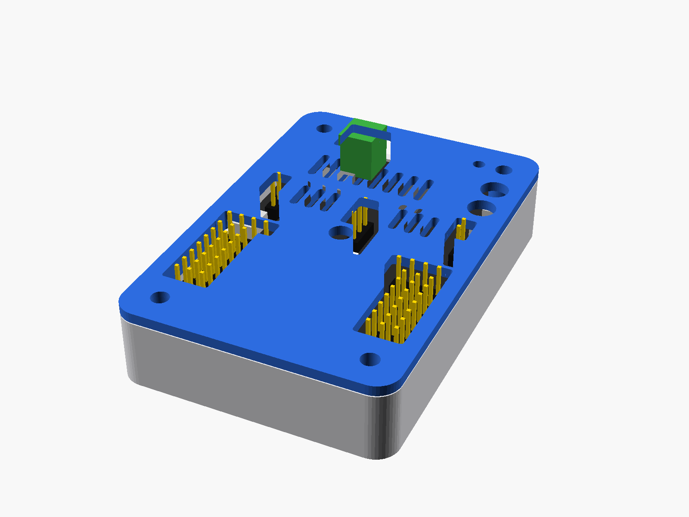

# Ficha de fabricación: carcasa impresa en 3D para la IdeaBoard

## Para qué sirve

Con esta ficha podés imprimir y armar una carcasa de dos piezas (base y tapa) para la placa **IdeaBoard de CRCibernética**. La carcasa protege la placa de golpes, rayones y cortos accidentales cuando se usa en talleres o clases. La tapa tiene ventanas para que puedas seguir conectando cables a los pines, al USB-C, a la bornera de alimentación y a los botones sin abrirla.

Está pensada para facilitadores, docentes o estudiantes que tienen una IdeaBoard y acceso a una impresora 3D de filamento (FDM).

> **Importante:** la documentación oficial de la IdeaBoard no publica medidas. Las de este diseño se **estimaron a escala** a partir de los dibujos oficiales, con un error posible de ±1 mm. Por eso el procedimiento empieza imprimiendo solo la tapa, como plantilla de prueba.

## Qué necesitás

**Archivos** (carpeta [`hardware/carcasa-ideaboard/`](../hardware/carcasa-ideaboard/)):

| Archivo | Qué es |
|---|---|
| `stl/tapa.stl` | Tapa, ya volteada para imprimir |
| `stl/base.stl` | Base |
| `carcasa_ideaboard.scad` | Modelo editable (solo si necesitás corregir medidas) |
| `step/tapa.step`, `step/base.step` | Para abrir y editar en Fusion 360, FreeCAD u otro CAD |

**Materiales y herramientas:**

- 1 IdeaBoard.
- Impresora 3D FDM con boquilla de 0,4 mm.
- Unos 25 g de filamento PLA. Usá PETG si la carcasa va a recibir golpes o va a estar cerca de motores calientes.
- 4 tornillos **M3 × 14 mm** de cabeza redonda. Pueden ser autorroscantes para plástico o tornillos M3 comunes, porque se roscan solos en el plástico.
- Destornillador que calce con la cabeza de los tornillos.
- Opcional: calibrador o regla en milímetros.
- Un programa laminador (*slicer*), que convierte el STL en instrucciones para la impresora. Por ejemplo: Bambu Studio, PrusaSlicer, Cura u OrcaSlicer (todos son gratuitos).

**Conocimientos previos:** saber abrir un STL en el laminador y mandar a imprimir. No hace falta saber modelar en 3D.

## Cómo hacerlo

1. **Descargá** `tapa.stl` y `base.stl`.
2. **Abrí `tapa.stl` en el laminador.** Tiene que quedar con la cara plana apoyada en la cama y los cilindros (bujes) hacia arriba. Si no aparece así, usá la opción "apoyar cara en la cama" (*lay on face*) sobre la cara plana.
3. **Configurá la impresión:** PLA, capa de 0,2 mm, 3 perímetros, 20 % de relleno y **sin soportes**.
4. **Imprimí solo la tapa** (unos 40 min, según la impresora).
5. **Probá la tapa como plantilla:** dala vuelta, para que los bujes queden hacia abajo, y apoyala sobre la IdeaBoard. La ventana cuadrada que está cerca de una esquina tiene que quedar sobre la bornera verde de tornillos. Revisá que:
   - los pines asomen por las ventanas sin tocar los bordes;
   - los 4 agujeros de las esquinas coincidan con los 4 agujeros de la placa;
   - los botones BOOT y RESET queden bajo los agujeros redondos.
6. **Si todo coincide, imprimí `base.stl`** con la misma configuración, apoyada sobre su piso y sin soportes (aprox. 1 h 30 min). Si algo no coincide, pasá a "Qué aprendimos" antes de seguir.
7. **Armá la carcasa:**
   1. Poné la IdeaBoard dentro de la base. Entrá primero el borde del USB-C, de modo que quede alineado con la ranura de la pared.
   2. Apoyá los agujeros de la placa sobre los 4 postes.
   3. Colocá la tapa. Su borde interior entra en la base y la centra.
   4. Atornillá los 4 tornillos desde arriba, en cruz. Pará cuando el tornillo haga tope; si seguís apretando, el plástico se barre.

## Cómo comprobar que funcionó

Con la carcasa cerrada:

| Prueba | Resultado esperado |
|---|---|
| Conectar un cable USB-C a la computadora | Entra hasta el fondo y aparece un puerto nuevo (COM en Windows, /dev/ttyUSB en Linux), o la placa se conecta en [IdeaCode](https://ideacode.crcibernetica.com/) o [IdeaScratch](https://ideascratch.crcibernetica.com/) |
| Conectar un cable dupont a un pin de cada bloque | Entra sin forzar |
| Presionar RESET con un dedo o con la punta de un lápiz | La placa se reinicia (el LED RGB parpadea o el programa vuelve a empezar) |
| Sacudir suavemente la carcasa | La placa no se mueve ni suena por dentro |
| Mirar por los costados | La placa no toca las paredes |

## Qué aprendimos y qué falta resolver

**Probado (en el modelo 3D):**

- La carcasa no choca con una maqueta de la placa (comprobación de interferencias en OpenSCAD).
- Las piezas se imprimen sin soportes.
- La tapa solo apoya sobre los anillos de los agujeros de montaje, no sobre pistas ni componentes.

**Pendiente (todavía no se probó físicamente):**

- Que las medidas estimadas coincidan con una IdeaBoard real.
- La altura real de los pines, la bornera y los botones.
- Que los tornillos M3 × 14 rosquen bien en PLA.

**Si algo no coincide:** abrí `carcasa_ideaboard.scad` en [OpenSCAD](https://openscad.org) (gratuito). Al principio del archivo están todas las medidas, con comentarios: `[EST]` significa estimada y `[PEND]` significa que falta medirla. Cambiá el valor, apretá F6 y exportá el STL nuevo (Archivo → Exportar → STL). Las más importantes son `pcb_w` y `pcb_l` (ancho y largo de la placa) y `holes` (posición de los agujeros).

**Recomendaciones:**

- Si la tapa entra muy justa en la base, subí `clr_fit` de 0.25 a 0.35.
- Si la vas a abrir muchas veces, usá insertos térmicos M3 (`use_inserts = true`).

**Extensión opcional:** en [`hardware/vigas/`](../hardware/vigas/) hay una placa adaptadora y vigas con cola de milano para montar la carcasa en un robot. Las vigas tienen agujeros donde entran los pines LEGO Technic. Todavía no se probó físicamente.

## Cómo podés contribuir

**Imprimí solo la tapa, apoyala sobre tu IdeaBoard y contanos qué coincidió y qué no.**

1. Abrí un *issue* en este repositorio con la plantilla **"Prueba de ajuste de la carcasa"**. Está en la pestaña *Issues* → *New issue*.
2. Contanos qué ventanas o agujeros quedaron corridos y, si podés, por cuántos milímetros, más una foto.
3. Si tenés calibrador, agregá el largo y el ancho de tu placa y la distancia entre los agujeros.

No hace falta saber programar ni modelar. Con tu medición cualquier persona puede corregir el archivo y pasar las medidas de "estimadas" a "verificadas".

## Autoría y fuentes

- **Autoría:** Equipo de diseño ModuBot, curso Activadores de Comunidades de Práctica (SINT-741): Alexandra Domínguez · Carlos Batista · Pablo Hernández Meléndez · Juan Quiel.
- **Origen:** diseño propio del grupo, hecho para usar la IdeaBoard en talleres de robótica educativa. El modelo se hizo con apoyo de un asistente de IA (Claude) y lo revisó el grupo.
- **Fuentes:**
  - [Wiki oficial de la IdeaBoard](https://github.com/CRCibernetica/circuitpython-ideaboard/wiki) (pinout y lista de componentes).
  - [Repositorio circuitpython-ideaboard](https://github.com/CRCibernetica/circuitpython-ideaboard).
  - La IdeaBoard es un producto de [CRCibernética](https://www.crcibernetica.com). Este recurso no es oficial ni está afiliado a ellos.
- **Licencia:** texto, imágenes y modelos 3D bajo [CC BY-SA 4.0](https://creativecommons.org/licenses/by-sa/4.0/deed.es). Podés usarlos, modificarlos y compartirlos citando al grupo y manteniendo la misma licencia.

## Revisión durante la clase

### Revisión con IA (como persona principiante)

Le pedimos a una IA (Claude): *"Lee esta guía como alguien que quiere realizar la actividad por primera vez. Usando solamente lo documentado, explica qué harías. Identifica información faltante y formula preguntas. No inventes materiales, pasos ni resultados."*

| Pregunta o vacío que detectó | Qué ajustamos |
|---|---|
| La tapa se imprime boca abajo: ¿hay que darla vuelta para probarla? | Lo aclaramos en el paso 5 |
| "Del mismo lado que las dos ventanas pequeñas" no se entiende | Cambiamos la referencia por la ventana cuadrada sobre la bornera verde |
| ¿Cómo sé que la computadora "detecta" la placa? | Indicamos qué puerto aparece y enlazamos IdeaCode/IdeaScratch |
| Se indica el tiempo de la tapa pero no el de la base | Agregamos un tiempo aproximado para la base |
| ¿Cómo sé que RESET funcionó si la placa no tiene un programa cargado? | Lo dejamos como duda abierta (ver abajo) |

**Duda abierta:** la prueba de RESET supone que la placa tiene un programa que muestre algo. Falta documentar un programa mínimo de prueba, o enlazar uno de la wiki.

### Revisión de otro grupo

*Completar en clase:*

| Pregunta | Respuesta del otro grupo |
|---|---|
| ¿Qué podemos hacer con este recurso? | |
| ¿Qué necesitamos para comenzar? | |
| ¿Cuál sería el primer paso? | |
| ¿Cómo sabríamos que funcionó? | |
| ¿Dónde necesitaríamos pedir ayuda? | |

**Tipo de prueba:** revisión de comprensión; la prueba práctica de impresión sigue pendiente.
**Qué ajustamos después:** *[completar]*
