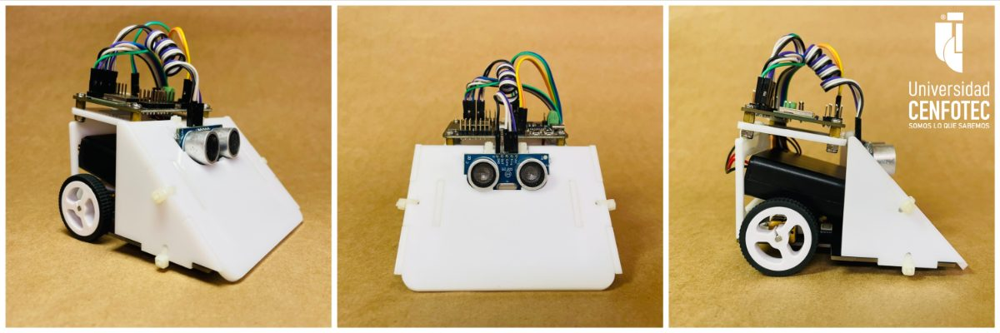

# Propuesta: Guía de primeros pasos y FAQ para principiantes del Sumobot



SINT-741 · Activadores de Comunidades de Práctica · Reto de clase 5 · Grupo 1, Arte y Cultura
Reto del 29 de octubre de 2026 · Entrega revisada por el grupo en noviembre de 2026

## Grupo

**Grupo 1 · Arte y Cultura.** Pregunta generadora: *¿qué objeto maker podría expresar la cultura local?*

| Integrante | Usuario de GitHub | Rol en el reto | Estado |
| --- | --- | --- | --- |
| Mario Esteban Barsallo Vásquez | `MarioLowPoly` | Redacción y publicación (responsable de entrega) | Por confirmar |
| Melvin Eugene Buford Bernal | `mbuford29` | Navegación | Por confirmar |
| Brittany Grace Charris Wardrope | `bcharris1024-cloud` | Navegación | Por confirmar |
| Jimena Londoño Castellano | `JimenaLondono` | Investigación con IA | Por confirmar |
| Yonathan Noel González Soto | Por confirmar | Investigación con IA | Por confirmar |
| Maykol Arcenio Rodríguez Herrera | `mrodriguezhe-alt` | Pregunta de principiante | Por confirmar |
| Serafín Blis Velasquez | Por confirmar | Pregunta de principiante | Por confirmar |

> Cada integrante confirma o corrige su rol con un comentario en el Pull Request; al confirmarlo, su estado pasa a «Confirmado». Quien no tenga usuario de GitHub confirmado debe avisarle al profesor.

## Contenido de esta entrega

| Archivo | Qué es |
| --- | --- |
| [`propuesta.md`](propuesta.md) | Esta propuesta |
| [`primeros_pasos.md`](primeros_pasos.md) | **Mejora A:** guía de primeros pasos en 6 etapas, ya construida |
| [`FAQ.md`](FAQ.md) | **Mejora B:** el FAQ del Sumobot con 5 preguntas nuevas ya respondidas |
| [`plantilla-pregunta-o-experiencia.md`](plantilla-pregunta-o-experiencia.md) | **Mejora C:** plantilla de Issue para que otros compartan dudas y experiencias |
| [`images/`](images/) | Imágenes tomadas del repositorio Sumobot, con crédito |

```
reto-05/
├── propuesta.md
├── primeros_pasos.md
├── FAQ.md
├── plantilla-pregunta-o-experiencia.md
└── images/
    ├── banner-sumobot-2025.jpg
    ├── componentes-kit-2025.jpg
    ├── armado-sumobot.jpg
    ├── conexion-baterias.jpg
    ├── thonny-sumobot.jpg
    ├── monitor-sensores.jpg
    └── dojo.jpg
```

## Repositorio analizado

| Dato | Detalle |
| --- | --- |
| Nombre | Sumobot (también llamado CenfoBot) |
| Enlace | <https://github.com/Universidad-Cenfotec/Sumobot> |
| Autoría | Diseñado por el profesor Tomás de Camino Beck para la Universidad CENFOTEC, con el shield hecho junto con CrCibernética. Tiene aportes de otras personas de la comunidad, como Fiorella Pérez y Gabriela Urbina Hernández, que firman algunos códigos de ejemplo. |
| Licencia | CC BY-NC-SA 4.0 (Atribución-NoComercial-CompartirIgual), declarada en la sección «Licencia» del README. No hay archivo `LICENSE` en la raíz. |
| Versión revisada | Último commit del 29 de octubre de 2026 («Add web monitor section for sensor data») |

## Qué es el proyecto

El Sumobot es un robot educativo pequeño y económico, hecho en Costa Rica, para competencias de sumo: dos robots autónomos se empujan dentro de un círculo (el *dojo*) y gana el que saca al otro. Usa la placa IdeaBoard, basada en ESP32, y se programa en CircuitPython.

Está pensado para colegiales, docentes, clubes de robótica y estudiantes universitarios. Resuelve un problema de acceso: aprender robótica suele exigir kits caros o importados, mientras que aquí las piezas se consiguen en el país y el diseño y el código son abiertos, así que cualquier institución puede reproducir el robot.

## Hallazgos con evidencia

| Hallazgo | Archivo o enlace que lo respalda |
| --- | --- |
| El README funciona como índice: la lista «Contenidos de este Repositorio» enlaza espíritu del torneo, componentes, armado, conexiones, programación, código de inicio, sensores, dojo, reglas y FAQ. | [`README.md`](https://github.com/Universidad-Cenfotec/Sumobot/blob/main/README.md) |
| Ninguna sección del README se llama «Primeros pasos» ni marca una ruta para principiantes. El orden de la lista sirve como recorrido, pero no se presenta como tal. | [`README.md`](https://github.com/Universidad-Cenfotec/Sumobot/blob/main/README.md) |
| El README no menciona Thonny. Sí existen dos guías paso a paso, `instala_thonny.md` y `uso_thonny.md`, pero solo se enlazan desde `programacion.md`. | [`programacion.md`](https://github.com/Universidad-Cenfotec/Sumobot/blob/main/programacion.md), [`instala_thonny.md`](https://github.com/Universidad-Cenfotec/Sumobot/blob/main/instala_thonny.md), [`uso_thonny.md`](https://github.com/Universidad-Cenfotec/Sumobot/blob/main/uso_thonny.md) |
| El propio repositorio reconoce que falta una guía para principiantes: `programacion.md` dice dos veces «Pronto publicaremos una guía básica», en las secciones de IdeaScratch e IdeaCode. | [`programacion.md`](https://github.com/Universidad-Cenfotec/Sumobot/blob/main/programacion.md), líneas 14 y 22 |
| El FAQ tiene 4 preguntas, todas sobre reglas: modificar el código, agregar sensores, modificar el chasis o los motores, y llevar el código preparado. Ninguna responde dudas de quien empieza. | [`FAQ.md`](https://github.com/Universidad-Cenfotec/Sumobot/blob/main/FAQ.md) |
| **Enlace roto:** el README enlaza `componentes2025.md`, pero ese archivo no existe; el archivo real es `componentes.md`. Es el segundo paso que daría un principiante. | [`README.md`](https://github.com/Universidad-Cenfotec/Sumobot/blob/main/README.md), línea 24 |
| **Enlace roto:** `códigos_de_ejemplo/README.md` enlaza `SumoBot_Device_Files.zip` en esa carpeta, pero el archivo está en `códigos_de_ejemplo/Old/`. `programacion.md` lo menciona para restaurar el robot. | [`códigos_de_ejemplo/README.md`](https://github.com/Universidad-Cenfotec/Sumobot/blob/main/c%C3%B3digos_de_ejemplo/README.md), línea 7 |
| **Nombres que no coinciden:** el README de fabricación menciona `chasis_sumobot_2025.svg` y `chasis_sumobot2025_3D.stl`, pero en la carpeta están como `Chasis_Sumobot_2025.svg` y `Chasis_Sumobot_3D_2025.stl`. | [`archivos_de_fabricacion/README.md`](https://github.com/Universidad-Cenfotec/Sumobot/blob/main/archivos_de_fabricacion/README.md) |
| **Explicación que se contradice:** en `sensores_infrarrojos.md`, el comentario del código dice «0-blanco, 1-negro» y el código devuelve 1 cuando la lectura es menor que 3000. Pero el texto explica lo contrario: que menor que 3000 es negro y se pone un 0. Para un principiante esto es confuso. | [`sensores_infrarrojos.md`](https://github.com/Universidad-Cenfotec/Sumobot/blob/main/c%C3%B3digos_de_ejemplo/sensores_infrarrojos.md), líneas 43 a 45 y 92 a 100 |
| **Falta guía de contribución:** el README remite a unas guías de contribución en la sección «Documentación», pero no hay `CONTRIBUTING.md` ni una sección con ese nombre. | [`README.md`](https://github.com/Universidad-Cenfotec/Sumobot/blob/main/README.md), sección «Contribuciones» |
| Ya existen herramientas útiles para probar: un programa de pruebas del dojo marcado «NO competitivo – SOLO PRUEBAS», un test de motores y un monitor web de sensores. | [`Prueba_Dojo.py`](https://github.com/Universidad-Cenfotec/Sumobot/blob/main/c%C3%B3digos_de_ejemplo/Prueba_Dojo.py), [`test_motores.py`](https://github.com/Universidad-Cenfotec/Sumobot/blob/main/c%C3%B3digos_de_ejemplo/test_motores.py), [monitor web](https://universidad-cenfotec.github.io/Sumobot/) |
| No verificado: si hay Issues abiertos que ya pidan una guía para principiantes. No revisamos la pestaña Issues. | [Issues de Sumobot](https://github.com/Universidad-Cenfotec/Sumobot/issues) |

## Oportunidad identificada

El repositorio tiene buena documentación técnica sobre componentes, ensamblaje, conexiones y programación, pero está repartida en varios archivos y no hay una ruta marcada para quien empieza. Una persona nueva no sabe por dónde comenzar, no ve en el README qué programa instalar y se encuentra con un enlace roto en el paso de componentes. Además, el FAQ solo responde dudas de reglas, no las preguntas típicas de un principiante. El mismo repositorio anuncia que «pronto» publicará una guía básica.

En clase vimos las señales de una memoria colectiva: propósito visible, contexto de origen, pasos reproducibles, créditos de cada aporte, invitación a contribuir y formato legible para personas e IA. El Sumobot cumple casi todas. Donde es más débil es en la **invitación a contribuir**: no hay guía de contribución y el FAQ no recoge las dudas de quienes lo prueban. Ahí se enfoca nuestra propuesta.

## Propuesta

**Mejorar la documentación del repositorio y llevar su modelo a nuestra comunidad**, sin modificar el robot ni su código. Las mejoras A, B y C ya están construidas en esta entrega como primera versión.

**A. [Guía de primeros pasos](primeros_pasos.md).** Seis etapas en orden. Cada una dice qué hacer, cómo saber que salió bien y qué documento existente leer, para no repetir información:

| # | Etapa | Documento existente al que enlaza |
| --- | --- | --- |
| 1 | Conoce el proyecto | `README.md`, `espiritu_sumobot.md` |
| 2 | Revisa el kit | `componentes.md` |
| 3 | Arma y conecta | `Armado paso a paso.md`, `conexiones.md`, `Conexiones SumoBot.pdf` |
| 4 | Prepara la computadora | `instala_thonny.md`, `uso_thonny.md`, `programacion.md` |
| 5 | Tu primer programa | `códigos_de_ejemplo/codigo inicio`, `test_motores.py`, `code_scan.py`, `sensores_infrarrojos.md` |
| 6 | Prueba en el dojo | monitor web de sensores, `Prueba_Dojo.py`, `dojo.md`, `reglas de competencia.md` |

**B. [FAQ ampliado](FAQ.md).** Conserva las 4 preguntas originales sin cambios y agrega 5 nuevas, cada una con su fuente:

5. ¿Qué conocimientos previos de programación o electrónica se necesitan?
6. ¿Cuál es una buena estrategia para empezar a programar el robot?
7. ¿Cómo pruebo y calibro el robot antes de competir?
8. ¿Qué herramientas básicas necesito para armarlo y configurarlo?
9. ¿Cuáles son los errores más comunes de los principiantes?

**C. [Canal de preguntas y experiencias](plantilla-pregunta-o-experiencia.md).** Una plantilla de Issue para que quien pruebe el Sumobot cuente su experiencia o deje una duda nueva. El FAQ y la guía la enlazan al final. Así el FAQ crece con lo que viven otros equipos.

**D. Qué adaptamos para nuestra comunidad.** Lo que más nos sirve del Sumobot es su forma de documentar: un índice en el README, un archivo por tema y un FAQ. Vamos a usar ese mismo modelo (guía en etapas, FAQ y canal de experiencias) en los recursos del Grupo 1, empezando por [*Tú Decides*](../reto-02/mapa-comunidad.md) (Reto 2), para que otra persona pueda continuarlos sin nosotros.

- **Para quién:** colegiales, docentes y clubes que arman su primer Sumobot sin experiencia previa en robótica.
- **Por qué es útil:** reduce las dificultades iniciales, aprovecha lo que la comunidad ya documentó, señala los enlaces rotos y nos deja un modelo de documentación que podemos reutilizar.

## Pasos para realizarla

| # | Paso | Recursos | Responsable | Estado |
| --- | --- | --- | --- | --- |
| 1 | Investigar la documentación del repositorio | README, `programacion.md`, `FAQ.md`, `componentes.md` | Melvin y Brittany (navegación) | ✅ Hecho |
| 2 | Seleccionar y organizar la información esencial, pidiendo a la IA la ruta de cada dato | Tabla de hallazgos | Jimena y Yonathan (investigación con IA) | ✅ Hecho |
| 3 | Escribir la guía de seis etapas | `primeros_pasos.md`, imágenes del repositorio | Melvin y Brittany | ✅ Primera versión |
| 4 | Redactar las cinco preguntas del FAQ y la plantilla de Issue | `FAQ.md`, `plantilla-pregunta-o-experiencia.md` | Jimena y Yonathan | ✅ Primera versión |
| 5 | Probar la guía con una persona que no conozca el Sumobot | Un estudiante voluntario, hoja de observación | Maykol y Serafín (pregunta de principiante) | ⏳ Pendiente |
| 6 | Abrir un Issue en el repositorio Sumobot que ofrezca la guía, el FAQ y la plantilla y reporte los enlaces rotos; si los mantenedores están de acuerdo, enviar un Pull Request | GitHub | Mario (redacción y publicación) | ⏳ Pendiente |

## Cómo comprobar que funciona

| # | Qué comprobamos | Cómo | Resultado |
| --- | --- | --- | --- |
| 1 | Orden y claridad | La guía sigue las 6 etapas y cada una cierra con «Listo cuando…» | ✅ Cumple |
| 2 | Enlaces | Revisamos que cada enlace a un archivo del repositorio apunte a un archivo que existe, y que la guía use `componentes.md` y no el enlace roto | ✅ Revisado el 19 de noviembre de 2026 |
| 3 | Respuestas verificables | Cada pregunta nueva del FAQ termina con «📄 Fuentes» | ✅ Cumple |
| 4 | Prueba con un principiante | Un estudiante que no conoce el Sumobot sigue la guía sin ayuda. Funciona si llega a instalar Thonny y a cargar un programa. Anotamos dónde se trabó y cuánto tardó | ⏳ Pendiente |
| 5 | Recepción | El Issue en el repositorio Sumobot recibe respuesta de los mantenedores | ⏳ Pendiente |
| 6 | Canal en uso | Al menos una persona fuera del grupo deja una pregunta o experiencia con la plantilla | ⏳ Pendiente |

## Cómo podría continuar otra persona

- Empezar por [`primeros_pasos.md`](primeros_pasos.md). Ya dice qué archivo del repositorio cubre cada etapa.
- Tomar alguno de estos pendientes, que dejamos abiertos a propósito para que otros contribuyan:
  - Hacer la prueba con un principiante (fila 4 de la tabla anterior) y mejorar la guía con lo que se observe.
  - Corregir en el repositorio Sumobot los enlaces rotos (`componentes2025.md`, `SumoBot_Device_Files.zip`) y los nombres de archivo de `archivos_de_fabricacion/README.md`.
  - Proponer que se aclare la explicación de `sensores_infrarrojos.md` (qué valor significa negro y cuál blanco).
  - Proponer un `CONTRIBUTING.md` para el repositorio y activar la plantilla en `.github/ISSUE_TEMPLATE/`.
  - Sumar a la pregunta 9 del FAQ errores reales que lleguen por el canal de experiencias.
- No hace falta saber programar para mejorar la guía; sí conviene leer `programacion.md` antes de tocar la etapa 4.
- Respetar la licencia CC BY-NC-SA 4.0: dar crédito al Sumobot de CENFOTEC, no usar el material con fines comerciales y publicar las obras derivadas con la misma licencia. Nuestros archivos ya incluyen esa nota.

## Uso de IA

- **Herramienta:** Claude (Anthropic).
- **Qué consultamos:** seguimos las cuatro fases del prompt del reto (comprender, investigar, proponer, documentar) y pedimos la ruta del archivo que respalda cada hallazgo. Después le pedimos ayuda para redactar la guía y el FAQ a partir de los documentos del repositorio, y para reducir y copiar las imágenes con su crédito.
- **Qué aprovechamos:**
  - La detección de los enlaces rotos, de los nombres de archivo que no coinciden y de la contradicción en `sensores_infrarrojos.md`.
  - La idea de enlazar cada etapa de la guía a un documento existente.
  - El primer borrador de la guía, el FAQ y la plantilla.
- **Qué verificamos y corregimos:**
  - Abrimos en GitHub cada archivo citado.
  - Una primera búsqueda marcó `Control_Movimientos.md` como inexistente por un error al escribir la ruta con tilde. Al revisarlo, el archivo sí existe y lo quitamos de los hallazgos.
  - En una primera versión dijimos que Thonny solo aparecía en `programacion.md`. Al revisar el repositorio completo encontramos `instala_thonny.md` y `uso_thonny.md`, corregimos el hallazgo y los usamos en la etapa 4 de la guía.
  - La IA propuso al principio una cubierta decorativa para el robot. El grupo la descartó y eligió mejorar la documentación para principiantes, que responde a un problema que vimos en el repositorio.
  - En la pregunta 9 del FAQ aclaramos que los errores salen de las advertencias de la documentación y no de experiencias de torneo, para no presentarlos como algo que no comprobamos.
  - Lo que no pudimos confirmar quedó marcado como «No verificado».
- **Retroalimentación en clase:** presentamos la idea en la sesión del 29 de octubre. La profesora Gabriela Urbina comentó que el repositorio tiene mucha información porque reúne cuatro ediciones del torneo, y nos pidió analizar también qué podemos adaptar o replicar en nuestra comunidad. Por eso agregamos la sección D. En la misma sesión se insistió en dar crédito a quien creó el proyecto y en dejar pendientes visibles para que otros contribuyan; por eso agregamos los pendientes y las notas de licencia.
- **Decisiones del grupo:** elegir el Sumobot, enfocarnos en la documentación para principiantes, definir las seis etapas y las cinco preguntas, no modificar el robot ni su código y revisar en grupo la versión final antes de entregarla.

## Referencias

- Repositorio Sumobot: <https://github.com/Universidad-Cenfotec/Sumobot>
- README (índice, licencia, contribuciones): <https://github.com/Universidad-Cenfotec/Sumobot/blob/main/README.md>
- Programación: <https://github.com/Universidad-Cenfotec/Sumobot/blob/main/programacion.md>
- Instalar y usar Thonny: <https://github.com/Universidad-Cenfotec/Sumobot/blob/main/instala_thonny.md> · <https://github.com/Universidad-Cenfotec/Sumobot/blob/main/uso_thonny.md>
- Preguntas frecuentes: <https://github.com/Universidad-Cenfotec/Sumobot/blob/main/FAQ.md>
- Componentes del kit: <https://github.com/Universidad-Cenfotec/Sumobot/blob/main/componentes.md>
- Armado paso a paso: <https://github.com/Universidad-Cenfotec/Sumobot/blob/main/Armado%20paso%20a%20paso.md>
- Sensores infrarrojos: <https://github.com/Universidad-Cenfotec/Sumobot/blob/main/c%C3%B3digos_de_ejemplo/sensores_infrarrojos.md>
- Archivos de fabricación: <https://github.com/Universidad-Cenfotec/Sumobot/tree/main/archivos_de_fabricacion>
- Imágenes originales: <https://github.com/Universidad-Cenfotec/Sumobot/tree/main/imagenes>
- Licencia CC BY-NC-SA 4.0: <https://creativecommons.org/licenses/by-nc-sa/4.0/deed.es>
- Reto de clase 5: <https://github.com/Universidad-Cenfotec/SINT-741-Curso-Activadores/blob/main/5.%20Retos/Reto_Clase_5.md>
- Entregas anteriores del grupo: [Reto 2 · Tú Decides](../reto-02/mapa-comunidad.md) · [Reto 3 · Guía para un primer encuentro](../reto-03/guia-primer-encuentro-y-responsabilidades.md)
