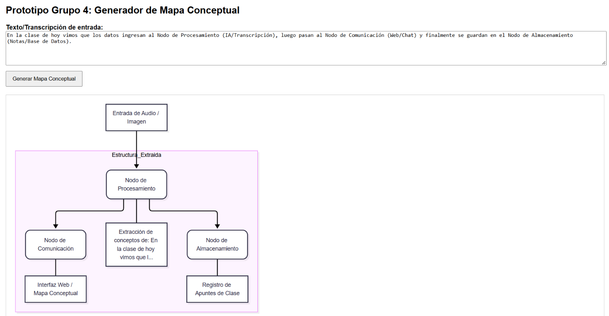
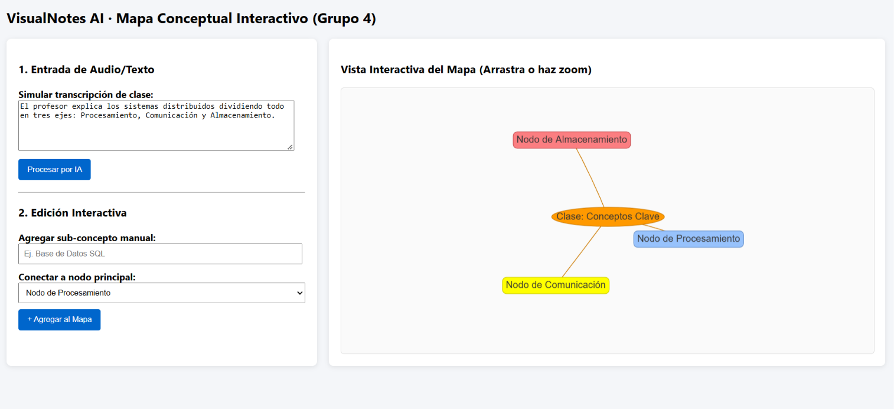
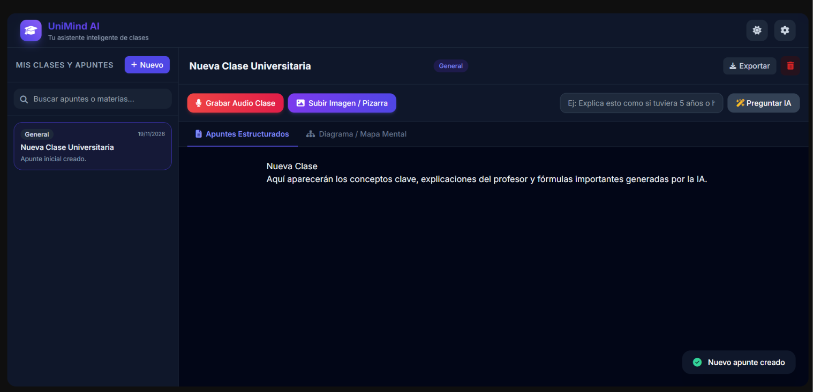

# Bitácora de activación — VisualNotes AI

> **Regla del proyecto:** registrar solo lo que ocurrió. Si una actividad no se pudo realizar, se anota y se explica qué se hará.
> Cada sesión se registra con el mismo formato: fecha, anfitrión, participantes, formato, duración, evidencia, dos interacciones, hipótesis vs. observación y ajuste.
> Los datos operativos se consolidaron en la sesión de cierre del 19 de noviembre con los acuerdos del equipo; las fechas del 15 y del 29 de octubre quedan fijadas en este registro para las versiones 2 y 3 del prototipo.

## Evolución del prototipo

Antes de la reunión del 4 de noviembre, el equipo pasó por tres versiones del prototipo. Estas imágenes son la evidencia de ese proceso:

| Fecha | Versión | Evidencia | Qué pasó |
|---|---|---|---|
| 2026-10-01 | Prototipo 1 |  | Primera versión, la más sencilla: permitía introducir texto y mostrar una representación visual básica de los conceptos |
| 2026-10-15 | Prototipo 2 |  | Se mejoró un poco la interfaz y la forma de mostrar los conceptos |
| 2026-10-29 | Prototipo 3 |  | Se le dio un poco más de forma; en esa fecha se usaba el nombre de trabajo `visualnoteia` |

> El 1 de octubre es la fecha indicada por el equipo. El 15 y el 29 de octubre quedan registrados con las versiones 2 y 3 según el acuerdo de cierre del 19 de noviembre.
> El 10 de octubre surgió el prototipo con el nombre `visualnoteia`; el nombre definitivo del repositorio publicado es `visualnotesia`.

## Índice de sesiones

| Activación | Fecha | Tema |
|---|---|---|
| [1](#activación-1) | 2026-10-01 | Nació la idea en la reunión de clase |
| [2](#activación-2) | 2026-10-04 | Primera reunión del equipo |
| [3](#activación-3) | 2026-10-10 | Asignaturas, reto semanal y nombre `visualnoteia` |
| [4](#activación-4) | 2026-10-15 | Despliegue del dominio y `CONTRIBUTING.md` |
| [5](#activación-5) | 2026-10-16 | Pruebas con usuarios externos y subida a GitHub |
| [6](#activación-6) | 2026-10-20 | Lógica de contribución y plan de sostenibilidad |
| [7](#activación-7) | 2026-10-22 | Resumen del avance |
| [8](#activación-8) | 2026-10-29 | Revisión de otros repositorios |
| [9](#activación-9) | 2026-11-03 al 05 | MD para colaborar con ideasense y reunión del equipo |
| [10](#activación-10) | 2026-11-14 | Armado del proyecto final |
| [11](#activación-11) | 2026-11-19 | Subida al repositorio con toda la información |

> El 22 de octubre se registró tal como lo indicó el equipo; en el calendario de 2026 ese día cae jueves. El 14 de noviembre sí fue sábado.

## Activación 1

**Tema:** nació la idea en la reunión de clase.

| Campo | Registro |
|---|---|
| Estado | Ejecutada |
| Fecha | 2026-10-01 |
| Persona anfitriona | Cesar Adrian Villamil Alzamora |
| Participantes | Los 6 integrantes del Grupo 4 y compañeros de la clase |
| Formato | Reunión de clase |
| Duración | 1:00 |
| Evidencia | [Mapa de Comunidad](mapa-de-comunidad.md) |

- **Interacción 1:** Cesar expuso que los apuntes de clase quedaban dispersos y propuso una herramienta web apoyada en IA.
- **Interacción 2:** Alice preguntó si la herramienta aceptaría audio y fotos de pizarra; el grupo aceptó esas fuentes junto con el texto como entradas iniciales.
- **Hipótesis → observación:** hacía falta una forma de organizar los apuntes → la idea surgió en clase y fue aceptada por el grupo.
- **Ajuste:** definir en una primera reunión del equipo qué se haría en la asignación.

## Activación 2

**Tema:** primera reunión del equipo; se definió lo que se haría en la asignación.

| Campo | Registro |
|---|---|
| Estado | Ejecutada |
| Fecha | 2026-10-04 |
| Persona anfitriona | Cesar Adrian Villamil Alzamora |
| Participantes | Los 6 integrantes del Grupo 4 |
| Formato | Reunión del equipo |
| Duración | 1:30 |
| Evidencia | [Mapa de Comunidad](mapa-de-comunidad.md) |

- **Interacción 1:** Cesar abrió la reunión y Samantha enumeró las entregas: mapa de comunidad, recurso reutilizable, prototipo y bitácora.
- **Interacción 2:** Josue propuso organizar el trabajo por responsabilidades; se acordaron facilitación, documentación, código e IA, revisión y pruebas.
- **Hipótesis → observación:** era necesario repartir el trabajo → se definió qué se haría en la asignación y quién seguiría cada frente.
- **Ajuste:** subir las asignaturas y organizar el reto de esa semana.

## Activación 3

**Tema:** asignaturas, reto semanal y aparición del nombre `visualnoteia`.

| Campo | Registro |
|---|---|
| Estado | Ejecutada |
| Fecha | 2026-10-10 |
| Persona anfitriona | Said Enrique Mendoza Acevedo |
| Participantes | Los 6 integrantes del Grupo 4 |
| Formato | Reunión del equipo |
| Duración | 1:00 |
| Evidencia | [Mapa de Comunidad](mapa-de-comunidad.md#4-práctica-compartida) |

- **Interacción 1:** Said subió las asignaturas y organizó el reto de esa semana alrededor de un material de clase real.
- **Interacción 2:** Josue propuso pulir la aplicación antes de compartirla y en esa conversación apareció el nombre de trabajo `visualnoteia`.
- **Hipótesis → observación:** el reto necesitaba material de apoyo → además del reto, surgió la propuesta de mejorar la app.
- **Ajuste:** preparar el despliegue de la aplicación y revisar su funcionamiento y lógica.

## Activación 4

**Tema:** despliegue de la app en un dominio; funcionamiento, lógica y creación de `CONTRIBUTING.md`.

| Campo | Registro |
|---|---|
| Estado | Ejecutada |
| Fecha | 2026-10-15 |
| Persona anfitriona | Said Enrique Mendoza Acevedo |
| Participantes | Los 6 integrantes del Grupo 4 |
| Formato | Reunión del equipo |
| Duración | 1:30 |
| Evidencia | [CONTRIBUTING.md](../CONTRIBUTING.md), <https://visualnotesia.nexusdigitalsolutions.group/>, [Prototipo 2](../imagenes/Prototipo2.png) |

- **Interacción 1:** Said desplegó la aplicación en el dominio y el equipo probó la generación de un apunte desde texto.
- **Interacción 2:** Alice detectó que la app funcionaba pero no explicaba cómo aportar, y redactó la primera versión de `CONTRIBUTING.md`.
- **Hipótesis → observación:** con la app funcionando bastaba para compartirla → hizo falta documentar cómo contribuir.
- **Ajuste:** comenzar pruebas con usuarios fuera del grupo y subir todo a GitHub.

## Activación 5

**Tema:** pruebas con usuarios fuera del grupo y subida de todo a GitHub.

| Campo | Registro |
|---|---|
| Estado | Ejecutada |
| Fecha | 2026-10-16 |
| Persona anfitriona | Alice Alexandra Rojas Vergara |
| Participantes | Los 6 integrantes del Grupo 4 y usuarios de prueba externos |
| Formato | Pruebas de uso y publicación |
| Duración | 1:00 |
| Evidencia | [Repositorio en GitHub](https://github.com/nexusdigitalsolutionspa-maker/visualnotesia) |

- **Interacción 1:** Samantha invitó a dos compañeros de otra sección a probar la app; ambos se detuvieron en el paso de subir un audio.
- **Interacción 2:** Cesar subió el material al repositorio con README y las primeras instrucciones de uso.
- **Hipótesis → observación:** en una primera etapa solo el equipo podía probar la app → usuarios externos empezaron a usarla y a señalar pasos confusos.
- **Ajuste:** mejorar la lógica de la contribución siguiendo el plan de sostenibilidad.

## Activación 6

**Tema:** mejora de la lógica de contribución según el plan de sostenibilidad.

| Campo | Registro |
|---|---|
| Estado | Ejecutada |
| Fecha | 2026-10-20 |
| Persona anfitriona | Alice Alexandra Rojas Vergara |
| Participantes | Los 6 integrantes del Grupo 4 |
| Formato | Reunión del equipo |
| Duración | 1:30 |
| Evidencia | [Plan de sostenibilidad](plan-de-sostenibilidad.md), [escalera de participación](../CONTRIBUTING.md#escalera-de-participación) |

- **Interacción 1:** Alice revisó la escalera existente y encontró que solo describía la acción de probar, sin decir cómo avanzar.
- **Interacción 2:** Samantha alineó los niveles con el plan: observador, probador, colaborador y facilitador, cada uno con una acción visible en GitHub.
- **Hipótesis → observación:** la contribución ya estaba clara → faltaba alinearla con el plan de sostenibilidad y con roles rotativos.
- **Ajuste:** hacer un resumen del avance del proyecto.

## Activación 7

**Tema:** resumen del avance.

| Campo | Registro |
|---|---|
| Estado | Ejecutada |
| Fecha | 2026-10-22 |
| Persona anfitriona | Samantha Valentina Matos Gutierrez |
| Participantes | Los 6 integrantes del Grupo 4 |
| Formato | Reunión del equipo |
| Duración | 0:30 |
| Evidencia | Registro en esta bitácora |

- **Interacción 1:** Samantha resumió el avance: dominio activo, repositorio público, recursos iniciales y escalera de participación.
- **Interacción 2:** Josue señaló que faltaba revisar cómo otros repositorios organizaban sus contribuciones.
- **Hipótesis → observación:** era conveniente hacer una pausa para resumir → el resumen permitió ver lo que faltaba.
- **Ajuste:** revisar otros repositorios para ver cómo se podía contribuir con VisualNotes AI.

## Activación 8

**Tema:** revisión de otros repositorios para encontrar formas de contribución.

| Campo | Registro |
|---|---|
| Estado | Ejecutada |
| Fecha | 2026-10-29 |
| Persona anfitriona | Samantha Valentina Matos Gutierrez |
| Participantes | Los 6 integrantes del Grupo 4 |
| Formato | Reunión del equipo |
| Duración | 1:00 |
| Evidencia | [Prototipo 3](../imagenes/Prototipo3.png), [recursos](../recursos/) |

- **Interacción 1:** Josue revisó tres repositorios de proyectos universitarios y mostró cómo usaban Issues y plantillas para recibir aportes.
- **Interacción 2:** Alice propuso preparar un MD específico para colaborar con ideasense y el equipo lo aceptó como siguiente paso.
- **Hipótesis → observación:** bastaba con mirar nuestro propio repositorio → revisar otros repos abrió nuevas formas de contribuir.
- **Ajuste:** definir el MD para colaborar con ideasense.

## Activación 9

**Tema:** definición del MD para colaborar con ideasense y reunión del equipo del 4 de noviembre.

| Campo | Registro |
|---|---|
| Estado | Ejecutada |
| Fecha | 2026-11-03 al 2026-11-05 (sesión del equipo el 2026-11-04) |
| Persona anfitriona | Josue Antonio Parfait Miranda |
| Participantes | Los 6 integrantes del Grupo 4 |
| Formato | Reunión del equipo |
| Duración | 2:00 Horas (sesión del 4 de noviembre) |
| Evidencia | [Mapa de Comunidad](mapa-de-comunidad.md), [Plan de sostenibilidad](plan-de-sostenibilidad.md) |

- **Interacción 1:** entre el 3 y el 5 de noviembre Josue coordinó el MD para colaborar con ideasense y lo dejó en la documentación del repositorio.
- **Interacción 2:** en la reunión del 4 de noviembre Cesar propuso mejorar la parte visual; Samantha señaló el mapa conceptual y la vista de transcripción, Alice sumó la propuesta de más mapas y Said pidió exportar el resumen en PDF.
- **Hipótesis → observación:** esperábamos que la reunión se centrara en generar apuntes con IA → la conversación giró hacia cómo se ve y se entrega el resultado; en la tercera versión del prototipo aún se usaba el nombre de trabajo `visualnoteia`.
- **Ajuste:** mejorar la parte visual, agregar más mapas y lograr que el resumen se exporte en PDF, en ese orden.

## Activación 10

**Tema:** armado del proyecto final: organizar información, recuperar recursos y afinar código (sábado 14 de noviembre).

| Campo | Registro |
|---|---|
| Estado | Ejecutada |
| Fecha | 2026-11-14 |
| Persona anfitriona | Cesar Adrian Villamil Alzamora |
| Participantes | Los 6 integrantes del Grupo 4 |
| Formato | Reunión del equipo |
| Duración | 2:30 |
| Evidencia | [README](../README.md), [Mapa de Comunidad](mapa-de-comunidad.md), [recursos](../recursos/), [imagenes](../imagenes/) |

- **Interacción 1:** Cesar organizó la información del proyecto final y Josue recuperó los recursos de las entregas anteriores.
- **Interacción 2:** Said afinó el código y Alice revisó que los documentos quedaran enlazados antes de publicar.
- **Hipótesis → observación:** los retos anteriores ya tenían casi todo el trabajo → hizo falta reorganizar los recursos y ajustar el código antes de publicar.
- **Ajuste:** subir al repositorio toda la información del proyecto final.

## Activación 11

**Tema:** subida al repositorio con toda la información.

| Campo | Registro |
|---|---|
| Estado | Ejecutada |
| Fecha | 2026-11-19 |
| Persona anfitriona | Alice Alexandra Rojas Vergara |
| Participantes | Los 6 integrantes del Grupo 4 |
| Formato | Publicación en GitHub |
| Duración | 1:00 |
| Evidencia | [README](../README.md), [Mapa de Comunidad](mapa-de-comunidad.md), [Plan de sostenibilidad](plan-de-sostenibilidad.md), [recursos](../recursos/), [imagenes](../imagenes/) |

- **Interacción 1:** Alice subió la documentación y verificó que el README enlazara el mapa, las entregas, la bitácora, los recursos y las imágenes.
- **Interacción 2:** Samantha abrió el [Issue #1](https://github.com/nexusdigitalsolutionspa-maker/visualnotesia/issues/1) para invitar a otras personas a probar VisualNotes AI y dejar comentarios.
- **Hipótesis → observación:** publicar los archivos era el último paso → además de publicarlos hubo que comprobar que estuvieran enlazados y crear un canal abierto de retroalimentación.
- **Ajuste:** presentar el proyecto en 5 minutos e incorporar los comentarios que lleguen al Issue y a la retroalimentación.

## Actividades no realizadas y pendientes

| Actividad | Estado | Responsable | Fecha prevista | Cómo se cerrará |
|---|---|---|---|---|
| Revisión de comprensión del plan como persona principiante | No ejecutada | Samantha Valentina Matos Gutierrez | 2026-11-25 | Entrada nueva en esta bitácora con las dudas y los ajustes |
| Republicar la landing con el repositorio ya público | No ejecutada | Cesar Adrian Villamil Alzamora | 2026-11-25 | Captura del sitio actualizado en la retroalimentación |
| Prueba de VisualNotes AI con otro grupo | No ejecutada | Josue Antonio Parfait Miranda | 2026-11-28 | Comentario en el [Issue #1](https://github.com/nexusdigitalsolutionspa-maker/visualnotesia/issues/1) y fila nueva en la retroalimentación |
| Exportación del resumen y el mapa a PDF | No ejecutada | Alice Alexandra Rojas Vergara | 2026-12-09 | Pull Request revisado y registro en esta bitácora |
| Pruebas automatizadas además de la verificación de sintaxis | No ejecutada | Said Enrique Mendoza Acevedo | 2026-12-09 | Workflow ampliado en `.github/workflows/ci.yml` |
| Verificar persistencia de la base de datos en el despliegue | No ejecutada | Said Enrique Mendoza Acevedo | 2026-12-12 | Anexo técnico del plan actualizado con el resultado |
| Registrar las respuestas nuevas del Issue #1 | En curso | Saret Medina | Cada semana | Retroalimentación y bitácora actualizadas |

---

Relacionado: [Mapa de Comunidad](mapa-de-comunidad.md) · [Plan de sostenibilidad](plan-de-sostenibilidad.md) · [Retroalimentación](retroalimentacion.md).
