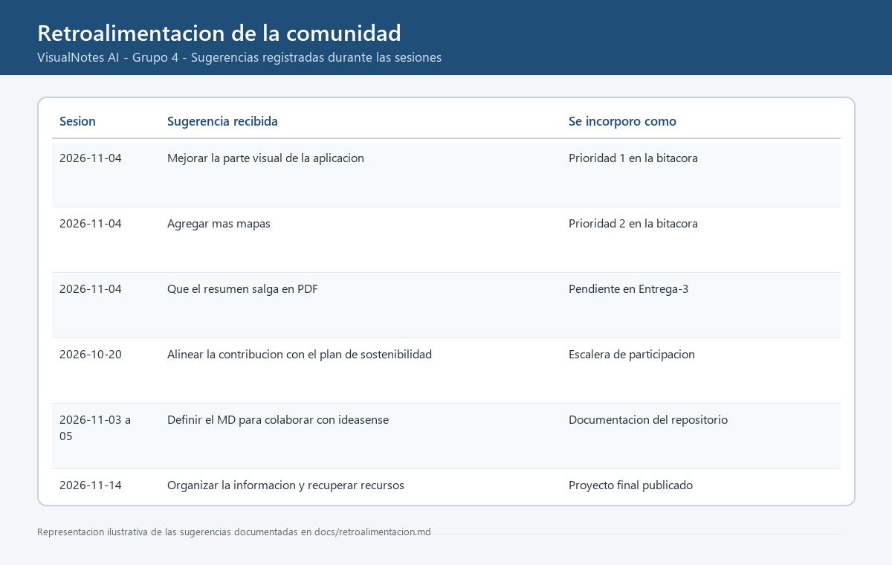

# Retroalimentación recibida e incorporada — VisualNotes AI

> Los comentarios se registran con su origen, el cambio que produjeron y el lugar del repositorio donde se ve ese cambio.
> La imagen de la sección [Evidencia visual](#evidencia-visual) reúne las sugerencias registradas en estas sesiones.

| # | Momento | Quién comentó | Qué dijo / qué se observó | Qué ajustamos | Dónde se ve el cambio |
|---|---|---|---|---|---|
| 1 | Reto 1 · Imaginar el cambio | Equipo y compañeros de clase (1 de octubre) | Hacía falta una herramienta para organizar los apuntes de clase | Definimos el dominio y la intención del proyecto | [Mapa de Comunidad](mapa-de-comunidad.md#1-situación-e-intención) |
| 2 | Reto 2 · Círculo generador y mapa | Equipo Grupo 4 (4 de octubre) | Había que definir quiénes formaban la comunidad y qué aportaban cada uno | Completamos participantes actuales, posibles participantes y capacidades | [Mapa de Comunidad](mapa-de-comunidad.md#3-comunidad) |
| 3 | Reto 3 · Experiencia continuable | Equipo Grupo 4 (10 y 15 de octubre) | La app debía pulirse y otra persona tenía que poder usarla sin que estuviéramos nosotros | Salieron el prototipo con nombre `visualnoteia`, el despliegue en dominio y la guía de uso | [Guía rápida](../recursos/guia-de-uso-rapida.md) |
| 4 | Reto 4 · Show & Tell | Usuarios de prueba y equipo (16 de octubre) | La salida visual costaba leer y faltaba una mejor presentación de los resultados | Priorizamos la mejora visual, más mapas y el resumen en PDF | [Bitácora](bitacora.md#activación-9) |
| 5 | Reto 5 · Exploradores a colaboradores | Usuarios externos y equipo (20 de octubre) | Faltaba una escalera clara para pasar de probar la app a colaborar | Ajustamos la lógica de contribución siguiendo el plan de sostenibilidad | [CONTRIBUTING.md](../CONTRIBUTING.md#escalera-de-participación) |
| 6 | Reto 6 · De mi proyecto a nuestra comunidad | Equipo Grupo 4 (29 de octubre al 5 de noviembre) | Había que revisar otros repositorios y definir el MD para colaborar con ideasense | Reunimos la documentación en `docs/`, `recursos/` e `imagenes/` y la enlazamos desde el README | [README](../README.md#🌱-comunidad-de-práctica-y-proyecto-final) |
| 7 | Semanas 7 y 8 · Observar y evaluar | Equipo Grupo 4 (14 y 19 de noviembre) | Faltaba recuperar los recursos de las entregas anteriores y ordenar toda la información | Armamos el proyecto final y lo subimos al repositorio con bitácora, entregas, recursos e imágenes | [Bitácora](bitacora.md#activación-10), [README](../README.md) |

## Evidencia visual

La imagen reúne las sugerencias de las sesiones y el lugar donde quedaron registradas: la mejora visual, más mapas, el resumen en PDF, la escalera de participación, el MD para ideasense y la organización del proyecto final.

## Cómo registramos un cambio

Cada fila se puede verificar: el origen del comentario se nombra, el ajuste se describe en una frase y el enlace apunta al archivo y la sección concretos. Si un comentario no generó un cambio, se escribe "Sin ajuste: decisión documentada" y se explica el motivo.

## Detalle de los cambios

- **1 → 4 de octubre:** la idea de clase se convirtió en una asignación con alcance definido.
- **10 → 15 de octubre:** el prototipo con nombre `visualnoteia` pasó a estar desplegado en un dominio y con `CONTRIBUTING.md`.
- **16 → 20 de octubre:** las pruebas con usuarios externos llevaron a alinear la contribución con el plan de sostenibilidad.
- **29 de octubre → 5 de noviembre:** la revisión de otros repositorios derivó en el MD para colaborar con ideasense.
- **14 → 19 de noviembre:** los recursos recuperados se convirtieron en el proyecto final publicado.

## Decisiones sin ajuste

- El nombre definitivo del proyecto siguió en discusión en el tercer prototipo; el tema se documentó en la [bitácora](bitacora.md#activación-9) en lugar de forzar una decisión.

---

El canal abierto para nuevos comentarios es el [Issue #1](https://github.com/nexusdigitalsolutionspa-maker/visualnotesia/issues/1): cada aporte se incorpora aquí y se registra en la bitácora.

Relacionado: [Uso de IA](uso-de-ia.md) · [Bitácora](bitacora.md) · [Mapa de Comunidad](mapa-de-comunidad.md) · [Plan de sostenibilidad](plan-de-sostenibilidad.md).
