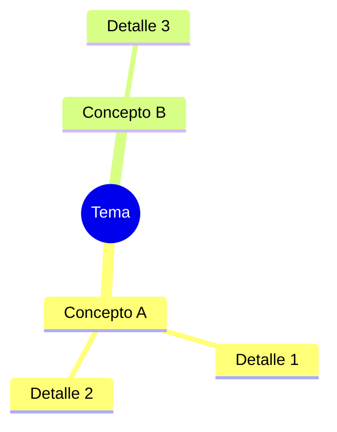

# Plantilla de kit de estudio

**Origen:** experiencia al compartir los resultados de `gemini_service.py`. La app genera transcripción, apuntes, palabras clave, mapa conceptual, resumen, quiz y recursos, pero cada persona los entregaba en un formato distinto. Sin una plantilla, reutilizar el trabajo de otra persona requería preguntarle cómo estaba organizado. Esta plantilla estandariza el kit sin cambiar el contenido.

**Uso:** copia este archivo, renómbralo con el tema (`ejemplo: modelo-lineal.md`) y rellena las secciones. Publícalo mediante un Pull Request o compártelo en tu propio fork.

---

````markdown
---
titulo: "[Tema del kit]"
fuente: "[audio / imagen / texto — indicar de dónde viene]"
fecha: "AAAA-MM-DD"
autor: "[nombre o rol, solo con autorización]"
revisado_por: "[nombre o rol]"
estado: "borrador / revisado"
---

# [Tema del kit]

## 1. Fuente original
- Tipo: `[audio / foto / texto]`
- Duración o extensión: `[completar]`
- Contexto: `[de qué clase o material viene]`

## 2. Transcripción literal
`[pegar la transcripción completa, sin omitir contenido]`

## 3. Contenido limpio y ordenado
`[agrupar por temas, conservar los conceptos importantes]`

## 4. Apuntes estructurados
`[apuntes en Markdown con encabezados y listas]`

## 5. Palabras clave
- `[palabra 1]`
- `[palabra 2]`
- `[palabra 3]`

## 6. Mapa conceptual (Mermaid)



## 7. Resumen ejecutivo
`[3 a 5 párrafos cortos con los conceptos fundamentales]`

## 8. Quiz de autoevaluación

1. `[Pregunta 1]`
   - a) `[opción]`
   - b) `[opción]`
   - **Respuesta:** `[b] — [por qué]`

2. `[Pregunta 2]`
   - a) `[opción]`
   - b) `[opción]`
   - **Respuesta:** `[a] — [por qué]`

## 9. Recursos recomendados
- `[Video / sitio / blog] — [por qué sirve]`

## 10. Revisión humana
- `[Qué corrigió la persona después de generar el kit]`
- `[Qué parte sigue dudosa y conviene verificar con el docente]`

## 11. Cómo reutilizar este kit
`[Por ejemplo: "Copia el archivo, cambia la fuente y vuelve a ejecutar la guía rápida. Si agregas un tema nuevo, abre un PR con tu versión."]`
````

---

## Checklist antes de compartir

- [ ] La transcripción está completa.
- [ ] Los apuntes están organizados por temas.
- [ ] El mapa conceptual se ve correctamente en Mermaid.
- [ ] El quiz tiene respuestas y explicación.
- [ ] Una persona revisó el contenido generado por IA.
- [ ] No aparecen datos personales sin autorización.

---

Relacionado: [Guía rápida](guia-de-uso-rapida.md) · [Uso de IA](../docs/uso-de-ia.md) · [Retroalimentación](../docs/retroalimentacion.md).
