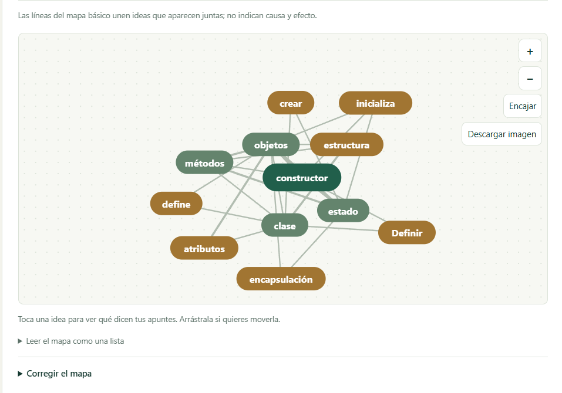
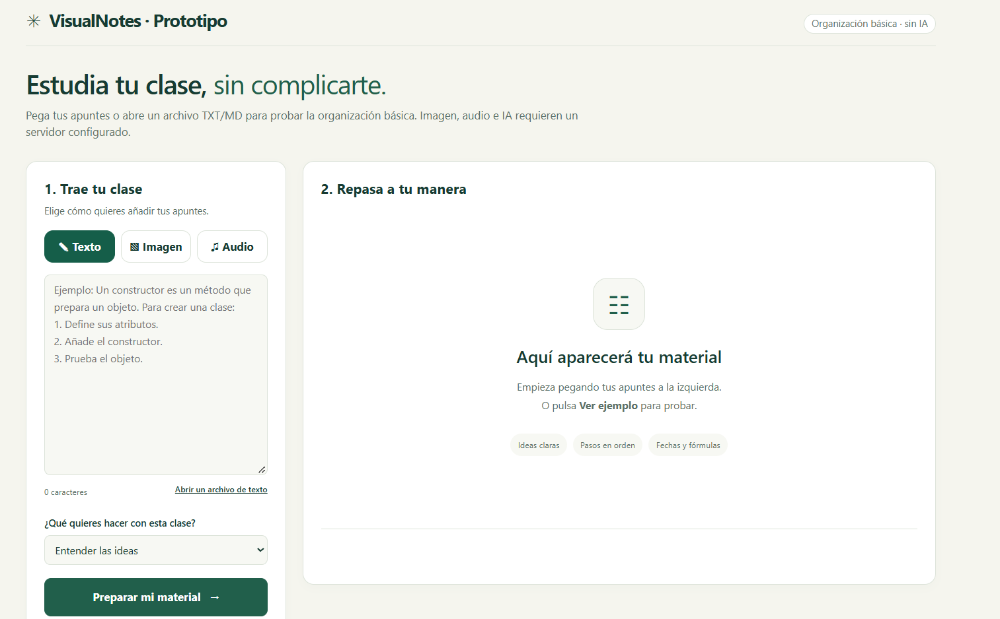
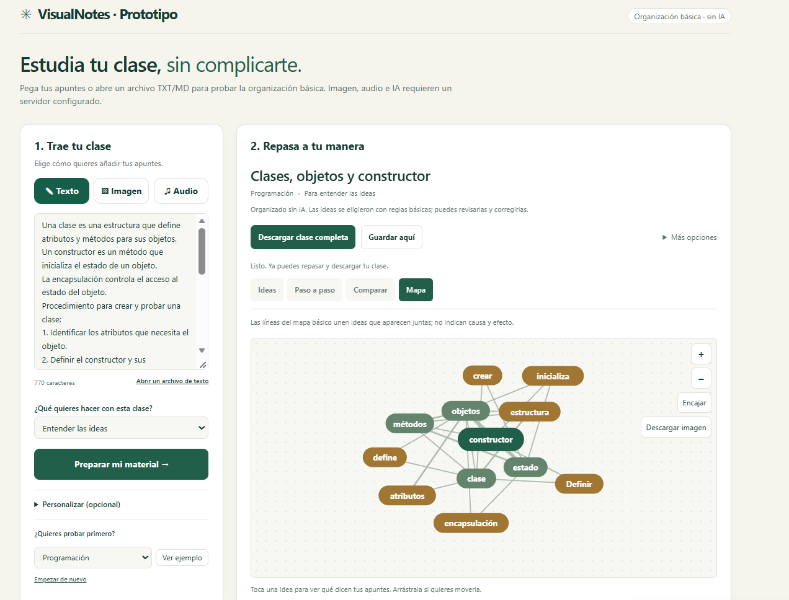

# VisualNotes: Mapa de Comunidad y Registro de Proyecto

**Grupo:** Grupo 4 (IA y Sistemas)

---

## 1. Nombre del proyecto

**VisualNotes**

## 2. Situación e intención

* **Qué nos interesa:** Resolver la dificultad que enfrentan los estudiantes universitarios al tomar notas a alta velocidad en clases complejas, lo que genera apuntes desorganizados e incompletos.
* **Qué queremos hacer posible:** Transformar información hablada o no estructurada (audios de clases o notas rápidas) en mapas conceptuales visuales e interactivos que permitan organizar los contenidos y repasar al propio ritmo.
* **Para quién:** Estudiantes universitarios.

## 3. Dominio

* **Campo de conocimiento:** Inteligencia Artificial aplicada a la educación, Asistentes de IA, Procesamiento de Lenguaje Natural (PLN), Transcripción de Audio y Desarrollo Web de interfaces visuales interactivas.

## 4. Comunidad

* **Participantes actuales:** Miembros del Grupo 4 (Círculo Maker).
* **Posibles participantes:** Estudiantes universitarios (usuarios probadores), docentes y desarrolladores de software educativo de código abierto.
* **Capacidades que el equipo aporta:**
  * Desarrollo web (HTML/JS/CSS).
  * Integración de asistentes de IA y visión artificial.
  * Sensores y electrónica.
  * Diseño de experiencia de usuario (UX/UI).
  * Coordinación y motivación de equipos.

## 5. Práctica compartida

* **Acciones recurrentes:** Sesiones periódicas de iteración rápida ("Círculos Maker"), pruebas de transcripción con fragmentos de audios reales de clases, refinamiento de prompts para la estructuración lógica de contenidos y revisiones de código en el repositorio de GitHub.
* **Recursos a utilizar:**
  * **Repositorio de GitHub:** `VisualNotes` para el control de versiones e infraestructura.
  * **Librerías de diagramación:** Mermaid.js / Vis.js para la generación dinámica de nodos y mapas.
  * **Servicios de IA:** Modelos de transcripción (Audio-to-Text) y procesamiento de texto a diagramas.

## 6. Trayectorias de participación

Para involucrar a nuevos participantes en la comunidad del proyecto, se definen los siguientes pasos:

* **Observar:** Revisar el archivo `README.md` del repositorio y probar la versión web ejecutable con transcripciones de ejemplo.
* **Preguntar:** Abrir un *Issue* en GitHub para consultar dudas sobre la estructura de nodos o la lógica de procesamiento.
* **Contribuir:** Enviar un *Pull Request* agregando soporte para nuevos formatos de entrada (ej. imágenes de apuntes a mano) o mejorando los estilos del mapa.
* **Acompañar:** Guiar a nuevos estudiantes o colaboradores en el uso del prototipo durante sus periodos de estudio.

## 7. Representación

Esquema del flujo del problema al resultado:

$$
\text{Entrada (Audio / Imágenes)} \xrightarrow{\quad\text{Transcripción + IA}\quad} \text{Salida Visual (Mapa Conceptual)}
$$

* **Arquitectura lógica de nodos:**
  1. **Nodo de Procesamiento:** Conceptos de análisis o lógica central extraídos de la clase.
  2. **Nodo de Comunicación:** Interacción, entrada/salida y flujo de información.
  3. **Nodo de Almacenamiento:** Datos clave, contexto y memoria del tema.

---

## 8. Prototipo y función

### Qué construimos / diseñamos

Un prototipo funcional web interactivo que utiliza HTML, JavaScript y la librería **Mermaid.js** para renderizar en tiempo real un mapa conceptual estructurado a partir de textos transcritos de clases.

### Qué debe hacer (Función)

Recibir un texto transcrito de una clase y organizar automáticamente los conceptos en tres ejes clave (Procesamiento, Comunicación y Almacenamiento), desplegando un mapa visual legible y navegable para el estudiante.

## 9. Prueba y aprendizaje

* **Qué esperábamos:** Que al ingresar una transcripción corta, la herramienta mostrara de forma clara los 3 nodos principales conectados y legibles.
* **Qué hicimos:** Configuramos una interfaz en HTML y JavaScript que integra Mermaid.js para simular el procesamiento de una transcripción e instanciar el mapa conceptual en pantalla.
* **Qué ocurrió:** El sistema logró desplegar la estructura visual correctamente, validando que separar la información en los ejes de *Procesamiento*, *Comunicación* y *Almacenamiento* permite sintetizar los apuntes de manera comprensible.
* **Qué cambiamos o cambiaríamos:** Implementar un modelo de IA en tiempo real (vía API) para realizar el filtrado automático del texto y añadir soporte directo para cargar archivos de audio recortados (de 30 a 60 segundos).

---

## 10. Capturas y Repositorio

#### Link de github: [josanto21/VisualNotes](https://github.com/josanto21/VisualNotes)

---

---

## 11. Continuidad

* **Próxima acción:** Integrar la captura de audio web / API de transcripción y pulir los estilos de la interfaz del mapa.
* **Responsables:** Equipo del Grupo 4.
* **Fecha acordada:** Próxima sesión del Círculo Maker.
